# Computer Networks, Phase 3: Research Implementation and Experimental Evaluation

## Observation Budgets and Padding Effects in Raw-Byte Network Traffic Classification

Muhammad Talha Arshad (i232548), Zain Shahid (i232582)

FAST-NUCES Islamabad, BS Data Science

---

## Summary

Phase 1 found that all twelve reviewed studies fix an observation budget (5 to 20 packets, or 784 to 1024 bytes) and that none of those values is derived from measurement. This phase treats the budget and the padding fraction as measured variables instead of preprocessing constants, on two corpora, with the controls needed to tell a result from an artifact.

The five findings that survived those controls:

1. **Every budget used in the reviewed literature sits at or past the point where accuracy stops improving**, on both corpora. The harder corpus saturates *earlier*, not later.
2. **The gain usually credited to padding-aware input is the input representation, not the padding symbol**, where the effect is large enough to decompose at all.
3. **Aggregate metrics conceal per-class failure in both directions.** The macro-to-weighted gap is positive on one corpus and negative on the other, so a reader who assumes its sign corrects the wrong way.
4. **A corpus described as encrypted traffic is mostly not confirmed encrypted**, and at a literature budget most of what the model reads is padding rather than traffic.
5. **How the test set is drawn is worth more than anything else measured here.** On the classes that can be split either way, letting train and test share a capture file is worth +0.3782 macro-F1 (0.94 against 0.56) with the classes, budget, model and split sizes held fixed. The temporal fallback this study uses sits near the honest arm; a random split, the likely default where a paper is silent, does not.

Two negative results are reported as negative rather than dropped: the padding attribution does not separate on USTC-TFC2016, and the length-balanced control is too small to give a magnitude on either corpus. A leakage gate halts the pipeline before any of this is reported, and it passed on both corpora.

---

### Where each required component is answered

The same map in repository terms is in `PHASE3.md`; this one is against the sections of this document.

| # | required component | section | what is there |
|---|---|---|---|
| **1** | Implementation of the Phase 2 framework | §1 | 13 modules; 4 verification scripts pass on synthetic data with a known answer |
|  | Changes from the original methodology | §1 | 7, each with the evidence that forced it |
| **2** | Dataset collection and selection | §2 | USTC-TFC2016 353,496 sessions / 20 classes; ISCX VPN-nonVPN 31,855 sessions / 11 classes |
|  | Preprocessing and feature engineering | §2 | once at a 2048-byte ceiling, then sliced per budget, so only the budget varies |
|  | Experimental setup, splits, implementation details | §2, §7 | group-wise where the corpus allows it, temporal where it does not; what that choice is worth is measured in §7 |
| **3** | Baseline implementation and evaluation | §3, §7 | 3 published baselines reimplemented and run at their own stated budgets, 3 seeds each, plus a byte transformer carrying the same sweep so the budget finding is not tied to one model family |
|  | Evaluation metrics | §3 | accuracy, macro-F1, weighted-F1, per-class precision/recall/F1/support |
|  | Statistical significance | §3 | McNemar's exact test on the paired comparisons, plus a seed-noise verdict on every difference |
| **4** | Graphical results | §4 | 10 figures in the body; every figure for both corpora in the appendices, as PNG and PDF |
| **5** | Comparison with existing research | §5 | 17 published results from the twelve reviewed papers, each with the settings it was obtained under |
|  | Limitations affecting fair comparison | §5 | a comparability obstacle recorded against every entry, not a league table |
| **6** | Ablation studies | §6 | four ablations plus the five-arm padding control, on both corpora; null results reported as null |
|  | Research validation | §3, §6, §7 | a leakage gate as a halt condition; the split-strategy confound measured rather than conceded |
| **7** | Results analysis and discussion | §7 | gap by gap against the four Phase 1 gaps, then Limitations |

---

## 1. Implementation of the proposed methodology

The Phase 2 methodology is implemented in `src/nettc/` as thirteen modules, driven by the scripts in `scripts/`. Preprocessing runs **once**, at a 2048-byte ceiling, into an HDF5 session store; every budget in the sweep is then served by slicing that store, so architecture, optimiser, schedule, seed and split are identical across budgets and the only thing that varies is how many bytes the model may see.

| module | covers |
|---|---|
| `pcapio.py` | streaming pcap and pcapng readers |
| `dissect.py` | five-tuple keying, anonymisation, field offsets (Step 3a, 3c) |
| `encryption.py` | TLS cipher-suite tagging and encryption strata (Step 3b) |
| `sessionize.py` | two-pass assembly, cleaning, deduplication (Steps 3a-3e) |
| `store.py` | the HDF5 session store (Step 3e) |
| `split.py` | group-wise 70/15/15 with a temporal fallback (Step 3f) |
| `slicer.py` | byte and packet budgets, padding modes, probe sources (Steps 4, 11ii) |
| `models.py` | Wang 2D, Wang 1D, Deep Packet, adaptive early-exit (Steps 5, 6) |
| `train.py` | one training loop for every model and budget |
| `metrics.py` | per-class, stratified, McNemar, Pareto frontier (Steps 8, 9) |
| `experiments.py` | E1-E4 and the padding controls (Steps 7, 11) |
| `ablations.py` | the four Step 10 ablations |
| `literature.py` | 17 published results from P1-P12 with comparability notes (Step 12) |

Correctness is established on synthetic captures whose answer is known by construction before any corpus is touched: a weak cue at byte 78 and a strong cue past byte 780. The sweep traces chance → 0.837 at 128 bytes → 1.000 at 1500 bytes, recovering the planted structure, and the leakage gate separates 1.000 before anonymisation from 0.125 after. Five verification scripts are listed in `tests/README.md`.

### Changes from the Phase 2 methodology

7 changes, each forced by something found while implementing or running. Lifted from `PHASE3.md`, which remains the requirement map.

1. **An input-representation axis was added.** Phase 2 Step 4 specified raw
   bytes normalised to [0, 1]. Implementation showed that this representation
   cannot match exact byte values (after scaling, two byte values one apart
   differ by 0.004) and on a corpus with a cue planted past byte 780 it
   plateaus at 0.492 macro-F1 while a learned byte embedding reaches 1.000.
   Since the budget curve is the study's primary instrument, and its shape
   depends on this choice, the representation is now swept as a variable
   rather than fixed. `--compare-representations` runs both.

2. **The padding control gained an attribution arm.** Step 11(ii) proposed
   comparing zero padding against a masked embedding. Those differ in two
   ways at once, and on synthetic data the combined effect is +0.519 macro-F1
   of which the padding symbol contributes +0.000. A fourth mode (`embed`:
   embedding input, ordinary zero padding) was added so the two are separable.

3. **The leakage control was split into three probes.** Step 11(i) described
   training on "the fields that were supposed to be anonymised", which is
   ambiguous. It is now: `id_positions` (those byte positions read from the
   *anonymised* store, the halt condition, which must sit at chance), `ident`
   (the same positions *before* anonymisation, context, expected to be high),
   and `ports` (the fields Step 3c deliberately retains, a reported risk, not a
   gate).

4. **The adaptive classifier's encoder is causal.** Step 5 specified early-exit
   heads at byte depths but not how to guarantee a head's output depends only
   on bytes before its depth. Without that guarantee the accuracy-per-byte
   frontier is meaningless. The encoder uses dilated causal convolutions and
   per-position normalisation; `tests/test_models_causality.py` asserts that
   head *k* returns bit-identical logits from a truncated and a full input.

5. **The split is group-wise *where the corpus allows it*, and temporal where
   it does not.** Step 3f specified a group-wise split with whole capture
   files held out. On real data that is often impossible: a class whose
   sessions come from fewer than three capture files has no files to hold out,
   and a class whose files are very unevenly sized can leave one of the three
   splits empty. `make_split` therefore falls back per class to a temporal
   split on first-packet timestamp, and records which strategy each class got
   so the reports can carry the caveat. This matters more than it sounds: 19
   of 20 USTC classes and 5 of 11 ISCX classes end up temporal, meaning train
   and test come from the same capture, the easier problem. It is a property
   of these corpora rather than a choice, but it bounds what the headline
   numbers mean, and the two corpora cannot be compared without it.

6. **The split strategy became an experiment rather than a caveat.** Change 5
   left the study's largest limitation unquantified: the corpus that scores
   higher is also the one split the easier way, and nothing in the Phase 2
   plan could separate those. Six ISCX classes have enough capture files to be
   split either way, which makes the question answerable within one corpus.
   `run_split_strategy.py` holds the classes, budget, model, epochs, seeds
   *and per-class split sizes* fixed and varies only where the train/test
   boundary falls: whole capture files, a timestamp inside those captures, or
   nothing. Matching the sizes is what turns it from a third confound into a
   measurement. The result is that a random within-capture split is worth
   +0.3782 macro-F1 over a group-wise one, while the temporal fallback this
   study actually uses is not measurably worse than group-wise (+0.0431
   against 0.0510 of seed noise). This was not in the Phase 2 plan; it exists
   because the limitation was worth measuring rather than conceding.

7. **The model family became a controlled variable.** Phase 2 fixed the
   classifier to the byte-image and byte-sequence CNNs the baselines come
   from. Every one of the twelve reviewed papers uses a transformer or a graph
   network instead, so a saturation point measured only under convolution
   could not be claimed to say anything about the architectures the field
   actually uses. A byte-level transformer (`models.ByteTransformer`: patch
   tokenisation by strided convolution, four pre-norm encoder layers, a
   key-padding mask) now carries the whole E2 sweep on ISCX with the store,
   split manifest, schedule and seeds held fixed. The two families are not
   separable: peaks of 0.5245 ± 0.0208 and 0.5195 ± 0.0379, saturating at the
   same packet budget. So the budget finding is a property of the data rather
   than of the convolutional stack. The transformer is trained from scratch
   and is not comparable to the pre-trained models it is modelled on; that is
   recorded as a limitation rather than worked around.


---

## 2. Dataset collection, preprocessing and experimental setup

|  | **USTC-TFC2016** | **ISCX VPN-nonVPN** |
|---|---|---|
| captures | 24 files | 140 files |
| captures contributing a unique session | 24 | 101 |
| sessions after cleaning | 353,496 | 31,855 |
| classes | 20 | 11 |
| median true length | 474 B | 274 B |
| median packet count | 3 | 2 |
| split strategy | 19 temporal, 1 group | 5 temporal, 6 group |
| per-class cap | none | 5,000 |
| epochs | 40 | 15 |
| seeds | 3 | 3 |
| train / test sessions | 249,457 / 51,963 | 22,962 / 4,047 |

Sessions are keyed by five-tuple, anonymised at the MAC and IP byte positions, deduplicated by content hash, and dropped if they carry no payload. Ports are deliberately **retained** (Step 3c, following P1's ablation) and the consequence is measured in §6 rather than assumed.

### The leakage gate

No result is reported until the same architecture, trained on restricted views of the input, fails to beat the majority class from the byte positions anonymisation was supposed to clear. This is a halt condition, not a diagnostic.

| probe | input | **USTC-TFC2016** | **ISCX VPN-nonVPN** |
|---|---|---|---|
| **gate** | MAC/IP positions, after anonymisation | 0.1351 | 0.1095 |
| context | the same positions, before anonymisation | 0.3851 | 0.5330 |
| risk | the retained port bytes | 0.7509 | 0.3019 |
|  | majority-class rate | 0.1359 | 0.2258 |
|  | **verdict** | **passed** | **passed** |

The context row is how much identifier shortcut the anonymisation destroyed; a pipeline that skipped that step would have had that much free accuracy. No reviewed paper runs this control.

---

## 3. Baseline implementation and evaluation

Three published baselines are reimplemented and run at their own stated budgets, with three seeds each.

| baseline | budget | **USTC-TFC2016** macro-F1 | **ISCX VPN-nonVPN** macro-F1 |
|---|---|---|---|
| Wang et al. 2017 byte image (28×28) | 784B | 0.9595 ± 0.0095 | 0.5108 ± 0.0099 |
| Wang et al. 2017 1D-CNN | 784B | 0.9564 ± 0.0018 | 0.5245 ± 0.0208 |
| Deep Packet (Lotfollahi et al. 2020) | 1500B | 0.9574 ± 0.0045 | 0.5018 ± 0.0258 |

Metrics are accuracy, macro-F1, weighted-F1, and per-class precision/recall/F1/support. Differences are judged two ways, because neither alone is honest at three seeds: a **seed-noise verdict** (a difference inside the seed-to-seed spread is reported as inconclusive, per Step 9) and, for comparisons that are paired on the same test sessions, **McNemar's exact test**.

### Paired significance tests

McNemar's exact test on per-sample correctness, same test sessions, same seed. It is applicable only where the two settings are scored on identical units, which rules out the granularity ablation (sessions and flows are different units) but covers the two claims the study most depends on.

| corpus | pair | A | B | discordant B→A/A→B | p | significant |
|---|---|---|---|---|---|---|
| USTC-TFC2016 | saturation | 512B 0.9895 | 784B 0.9434 | 94/2488 | 0 | **yes** |
| USTC-TFC2016 | ports | ports retained 0.9895 | ports masked 0.9477 | 107/2277 | 0 | **yes** |
| ISCX VPN-nonVPN | saturation | 256B 0.3939 | 784B 0.4136 | 254/174 | 0.000129 | **yes** |
| ISCX VPN-nonVPN | ports | ports retained 0.3939 | ports masked 0.3981 | 234/217 | 0.451 | no |

*Discordant counts are sessions one setting got right and the other got wrong, in each direction; McNemar tests whether that split is lopsided.*

**USTC-TFC2016: the paired test goes further than the seed-noise verdict.** The paired test compares 512B against 784B on the same 2,582 sessions that the two models answered differently (p = 0). It favours **512B**, the smaller budget, by 2,488 sessions to 94. Reading on to 784B does not merely stop helping, it **actively hurts**, and reliably so.

That is a stronger statement than the seed-noise verdict can make. A budget past saturation is not a harmless over-collection: the extra bytes are mostly padding at these lengths, and training on them costs accuracy as well as collection cost.

**ISCX VPN-nonVPN: the two instruments disagree, and the disagreement is informative.** The paired test compares 256B against 784B on the same 428 sessions that the two models answered differently (p = 0.000129). It favours **784B**, the larger budget, by 254 sessions to 174, yet the gain of +0.0184 macro-F1 is smaller than the 0.0326 spread between seeds.

Both are correct, because they ask different questions. McNemar asks whether *this* model beats *that* one on these sessions, and with thousands of paired sessions it detects a small effect easily. The seed-noise verdict asks whether the advantage survives simply retraining with another seed. So the extra bytes buy a little, and less than the noise a practitioner already lives with, while the collection cost scales with every one of them.

Taken together the two corpora make the budget case from opposite directions: on one, reading past the saturation point measurably *hurts*; on the other it helps by less than the seed-to-seed spread. Neither supports the budgets the literature inherits.

---

## 4. Graphical results

Figures are generated into `results/<corpus>/figures/` as both PNG and PDF. The ones that carry the argument are reproduced here; the rest are in the appendices.


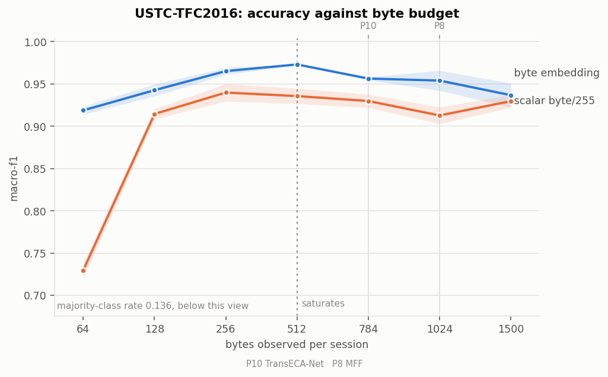

*USTC-TFC2016: Accuracy against byte budget, with the reviewed papers' choices marked. The saturation point is well below every one of them.*


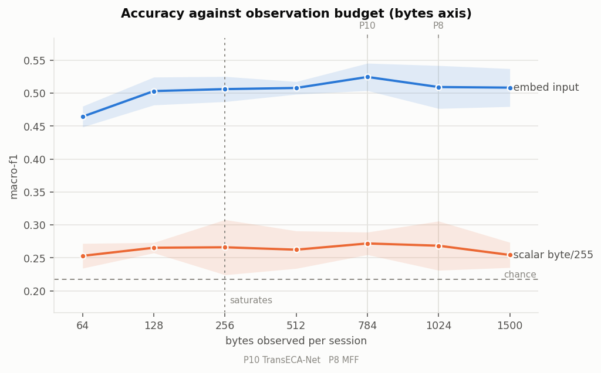

*ISCX VPN-nonVPN: Accuracy against byte budget, with the reviewed papers' choices marked. The saturation point is well below every one of them.*


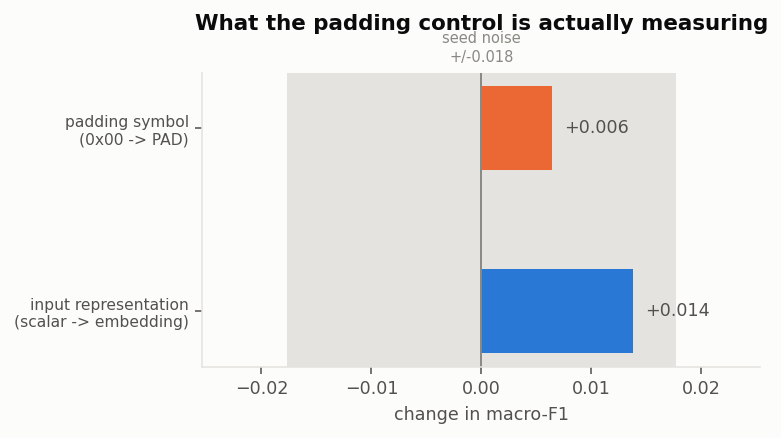

*USTC-TFC2016: The padding control split into its two arms, against the seed-noise band.*


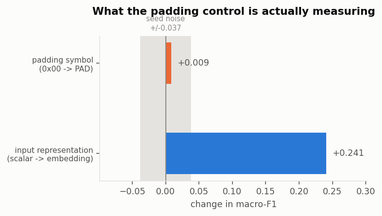

*ISCX VPN-nonVPN: The padding control split into its two arms, against the seed-noise band.*


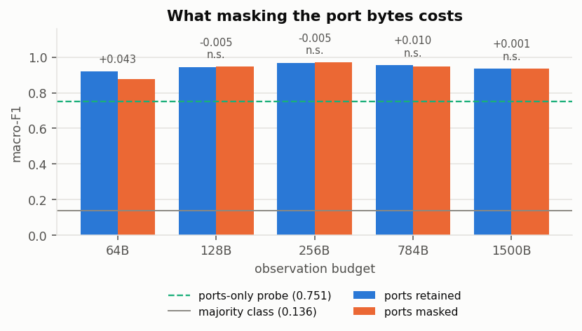

*USTC-TFC2016: What masking the four port bytes costs, against the ports-only probe.*


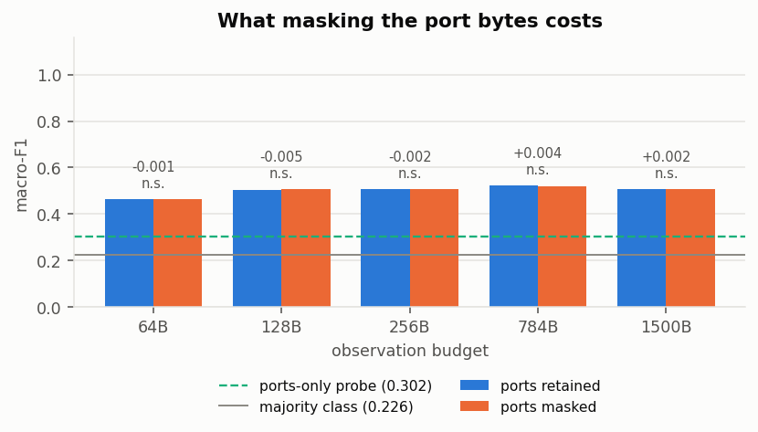

*ISCX VPN-nonVPN: What masking the four port bytes costs, against the ports-only probe.*


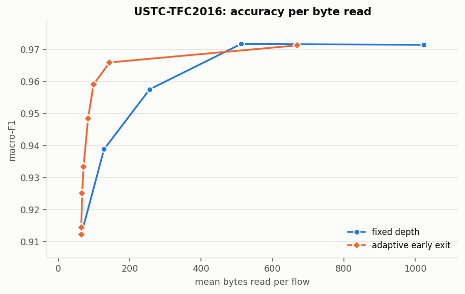

*USTC-TFC2016: Fixed budgets against the adaptive early-exit policy.*


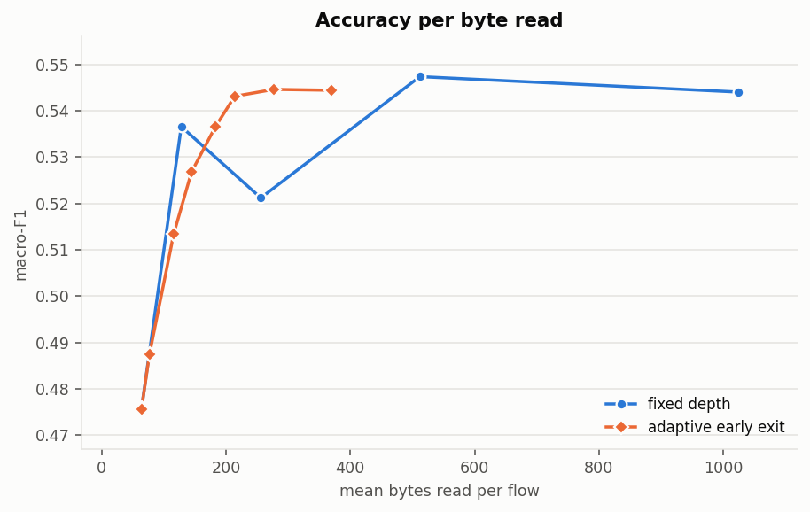

*ISCX VPN-nonVPN: Fixed budgets against the adaptive early-exit policy.*


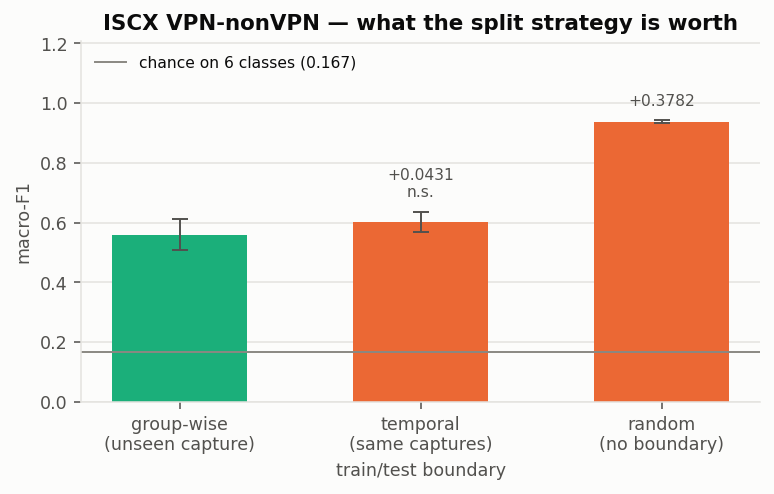

*ISCX VPN-nonVPN: Macro-F1 against where the train/test boundary falls, with everything else held fixed.*


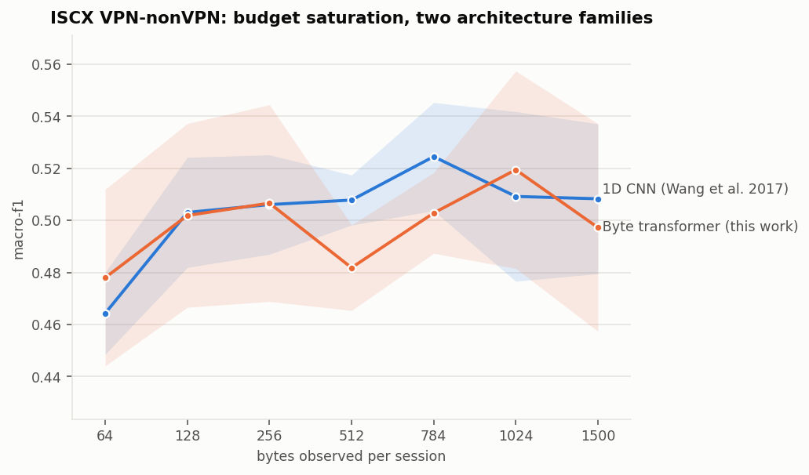

*ISCX VPN-nonVPN: The same budget sweep under a 2017 convolutional network and a byte transformer. The bands are seed spread.*

---

## 5. Comparison with existing research

Seventeen published results from the twelve reviewed papers are held in `literature.py` with the settings each was obtained under. The full tables, with a comparability obstacle recorded against every entry, are in `results/<corpus>/comparison_with_literature.txt` and in the appendices.

### Where this study's budgets fall against the literature's

| corpus | byte saturation | packet saturation | paper budgets compared | at or past saturation |
|---|---|---|---|---|
| USTC-TFC2016 | **512B** | **5P** | 6 | 6 of 6 |
| ISCX VPN-nonVPN | **256B** | **2P** | 6 | 6 of 6 |

No reviewed paper derives its budget from a sweep. P7 states plainly that its budget was chosen to fit a model's 512-token ceiling. On both corpora every one of those inherited budgets sits at or past the point where accuracy stops improving.

### What makes a fair comparison impossible

Published numbers are not directly comparable with these, and the obstacles are recorded rather than ignored:

- **Different class taxonomies.** The ISCX release obtained here is missing the non-VPN `p2p` captures, so every ISCX number is on 11 classes where papers using the full taxonomy report 12.
- **Different splitting.** A paper that splits randomly within captures is measuring an easier problem than one that holds whole captures out; most do not say which they did.
- **Different input representation.** The budget curve's shape depends on it, as §6 shows, so budget figures quoted across papers that differ here are not comparable.
- **Different preprocessing.** Deduplication and payload-empty dropping change the session count by a fifth on ISCX alone.

The one external check that does line up: ISCX is **87.9% padded at a 1024-byte budget**, against the roughly 87% implied by P8's own statistics from entirely independent preprocessing.

---

## 6. Ablation studies

Each ablation reports a verdict of *inconclusive* where the difference falls inside the seed-to-seed spread, rather than reporting the sign of a difference that three seeds cannot distinguish from noise.

| ablation | **USTC-TFC2016** | **ISCX VPN-nonVPN** |
|---|---|---|
| (i) representation, matched budget | inconclusive | inconclusive |
| (ii) layer scope: all / headers / payload | inconclusive | inconclusive |
| (iii) session against unidirectional flow | inconclusive (+0.0045) | session better (-0.0976) |
| (iv) early-exit supervision | inconclusive | inconclusive |
| padding: representation arm | +0.0138 | +0.2408 |
| padding: PAD-symbol arm | +0.0065 | +0.0086 |
| padding: seed noise | 0.0176 | 0.0373 |
| ports: largest macro-F1 lost to masking | +0.0428 | +0.0040 |
| length equalised: macro-F1 against chance | 0.7907 vs 0.1429 | 0.1106 vs 0.1667 |

**The padding gain is the representation, not the padding symbol, where the effect is large enough to tell.** On USTC-TFC2016 the whole effect is +0.0203 against 0.0176 of seed noise, too small to split; on ISCX VPN-nonVPN the representation is worth +0.2408 and the padding symbol +0.0086, against 0.0373 of seed noise. So the attribution is carried by ISCX VPN-nonVPN, where the effect is big enough to decompose. Elsewhere the control returns a null result: that is not evidence the padding symbol helps, it is the absence of evidence either way, and it is reported as such rather than pooled into an average that would look conclusive.

**The unit of analysis matters on one corpus and not measurably on the other.** On USTC-TFC2016 the difference is +0.0045 macro-F1 against 0.0304 of seed noise (inconclusive); on ISCX VPN-nonVPN the difference is -0.0976 macro-F1 against 0.0275 of seed noise (session better). Only ISCX VPN-nonVPN separates them, and it does so in the direction the confound argues against: flows are shorter than their parent sessions, so at a fixed budget the flow setting sees a larger share of each unit and still loses. Pairing the two directions of a conversation carries information that reading them separately does not, at least where the classes are hard enough for it to show. On the easier corpus everything is near ceiling and the question does not arise.

**Equalising flow length destroys the signal on one corpus and not the other.** USTC-TFC2016 scores 0.7907 against a 0.1429 chance rate on 168 test sessions; ISCX VPN-nonVPN scores 0.1106 against a 0.1667 chance rate on 84 test sessions. So on USTC-TFC2016 content still separates the classes with length held fixed, while on ISCX VPN-nonVPN very little does, which would put much of that corpus's apparent accuracy on flow length rather than on content. This is the sharpest disagreement between the two, and it is a reason not to generalise a padding or budget result from one corpus to the other. Both figures rest on a test set in the low hundreds, so the direction is what should be read here, not the magnitude.

---

## 7. Results analysis and discussion

The four gaps Phase 1 identified, answered against both corpora. Per-corpus detail, including the stratified breakdowns, is in the appendices.

### Gap 1: the observation budget is inherited, not measured

|  | **USTC-TFC2016** | **ISCX VPN-nonVPN** |
|---|---|---|
| byte budget where the sweep saturates | **512B** | **256B** |
| packet budget where the sweep saturates | **5P** | **2P** |
| best macro-F1 anywhere in the sweep | 0.9731 | 0.5245 |
| macro-F1 at the saturation point | 0.9731 | 0.5061 |
| what the best larger budget adds | -0.0167 | +0.0184 |
| seed noise | 0.0142 | 0.0326 |

**This is the study's clearest result.** Every budget used in the reviewed literature sits at or past the point where accuracy stops improving, on both corpora, and the harder corpus saturates *earlier*, which is the opposite of what a reader would assume.

The paired test says the same thing per session rather than per run: on USTC-TFC2016, 784B against 512B gives p = 0 (significant); on ISCX VPN-nonVPN, 784B against 256B gives p = 0.000129 (significant).


The practical consequence is a collection cost. A classifier that reads the saturation budget instead of the literature's gets the same accuracy from a fraction of the bytes, which on a live link is the difference between what has to be captured, buffered and held in memory per flow.

### Gap 2: minority classes failing inside aggregate metrics

|  | **USTC-TFC2016** | **ISCX VPN-nonVPN** |
|---|---|---|
| accuracy | 0.9409 | 0.4013 |
| macro-F1 | 0.9245 | 0.5110 |
| weighted-F1 | 0.9378 | 0.3798 |
| **concealment gap** | **+0.0133** | **-0.1313** |
| worst class | `Skype` F1 0.734, recall 0.580 on 914 | `vpn_chat` F1 0.080, recall 0.042 on 686 |

**The gap changes sign between the corpora.** On USTC-TFC2016 a weighted average flatters the per-class picture, the direction Phase 1 anticipated. On ISCX it is strongly negative: the frequent classes are the hard ones, so a weighted average reports *worse* than a macro average. A reader who assumes the sign corrects in the wrong direction on one of the two.

On ISCX `vpn_chat` reaches 0.042 recall on 686 test sessions, a well-populated class the model almost never predicts, invisible in an aggregate of 0.40 accuracy. By class support the *smallest* classes score highest on both corpora, which inverts the literature's framing; but class support and split strategy are confounded here, so that ordering is not safe to read as a statement about support.

### Gap 3: how much of the corpus is actually encrypted

|  | **USTC-TFC2016** | **ISCX VPN-nonVPN** |
|---|---|---|
| definitely not encrypted | 41.3% | 27.6% |
| confirmed TLS | 7.8% | 7.4% |
| **encrypted share lies between** | **7.8% and 58.7%** | **7.4% and 72.4%** |
| of parsed handshakes, deprecated suites | 95.2% | 13.5% |
| padded rather than truncated at 784 B | 57.6% | 87.0% |
| padded rather than truncated at 1024 B | 60.3% | 87.9% |

Reported as bounds because the tagger resolves only part of each corpus: a session with no readable handshake may be encrypted, tunnelled, or too short to tell. The useful half is the lower bound of under 8% of either corpus as *confirmed* encrypted traffic, which is less than a paper describing these as encrypted-traffic benchmarks implies.

The cipher age has to be measured per corpus rather than assumed: 95.2% of USTC's parsed handshakes use a now-deprecated suite against 13.5% of ISCX's. And at the budgets the literature uses, most sessions are shorter than the budget, so much of what the model reads is padding. No reviewed paper reports that fraction.

### Gap 4: shortcut learning and the positive control

|  | **USTC-TFC2016** | **ISCX VPN-nonVPN** |
|---|---|---|
| gate: anonymised ID positions | 0.1351 | 0.1095 |
| majority-class rate | 0.1359 | 0.2258 |
| **gate verdict** | **passed** | **passed** |
| context: same positions, pre-anonymisation | 0.3851 | 0.5330 |
| risk: ports-only probe | 0.7509 | 0.3019 |
| largest macro-F1 lost to masking ports | +0.0428 | +0.0040 |

**The gate passed on both corpora**, so anonymisation left no usable identifier signal. The context row shows how much shortcut it destroyed: a pipeline that skipped that step would have had that much free accuracy, and no reviewed paper runs this control.

Ports are the interesting case, because the two measurements disagree and both are needed. A ports-only probe scores far above chance, strongly so on USTC, yet masking those bytes costs the full model almost nothing. The shortcut is *available* but redundantly encoded, so the model does not depend on it.
 The paired test agrees: on USTC-TFC2016, p = 0; on ISCX VPN-nonVPN, p = 0.451.


The probe alone would have condemned a design that is actually sound; the masking alone would have missed a real risk. Reporting only one of them, which is the usual practice, gives the wrong answer either way.

### The split-strategy confound, measured

The limitation above is testable on the 6 ISCX VPN-nonVPN classes that have enough capture files to be split either way. It cannot be run on USTC-TFC2016, where only 1 class of 20 has enough capture files to be split both ways, which is itself part of the problem.

The three arms hold the classes, the budget (256B), the model, the epochs and *the per-class train/val/test sizes* fixed, and vary only where the train/test boundary falls. 8 seeds; 14,697 training and 2,275 test sessions in every arm; chance 0.1667.

| train/test boundary | accuracy | macro-F1 | vs group-wise | verdict |
|---|---|---|---|---|
| **group-wise**: test captures unseen in training | 0.5388 | 0.5596 ± 0.0510 | (reference) |  |
| **temporal**: same captures, test is later in time | 0.6439 | 0.6027 ± 0.0337 | **+0.0431** | inconclusive |
| **random**: same captures, no time boundary | 0.9463 | 0.9378 ± 0.0046 | **+0.3782** | inflated |

**A random within-capture split is worth +0.3782 macro-F1.** The same 6 classes, the same budget, the same model and the same split sizes score 0.9378 when the test set may share captures with training and 0.5596 when it may not, 7 times the seed noise. An accuracy of 0.95 on this corpus is reachable without the model generalising past the capture file at all. That is the arm a paper which does not state its split policy has most likely taken, and on this corpus it is larger than the budget, the padding representation and the port shortcut combined (0.2632).

**The temporal fallback this study relies on is not measurably worse than a group-wise split**: +0.0431 against 0.0510 of seed noise. The limitation above therefore survives in a weaker form than it was stated in: the fallback sits near the honest arm rather than near the random one, so the headline numbers are not inflated the way a random split's would be. The difference may be real and too small to resolve at 8 seeds; it is not large.

The arms score different test sessions, so no paired test applies and the verdict is the seed-noise rule of Step 9. The group arm is the noisiest of the three, because whole capture files move between splits, which raises the bar any difference has to clear. And these 6 classes are the ones with enough captures to split both ways, which is not a random property.

### Does the budget curve depend on the architecture?

Every baseline in §3 is a convolutional network from 2017 to 2020, while all twelve reviewed papers are transformers or graph networks. If the saturation point were an artefact of convolution, the finding would not transfer to the architectures the field has moved to. So the whole byte- and packet-budget sweep was re-run on ISCX VPN-nonVPN with a byte-level transformer (patch tokenisation by strided convolution, four pre-norm encoder layers, four heads, a learned byte embedding and a key-padding mask) on the same store, the same split manifest, the same schedule and the same seeds. Only the model differs.

| model | peak macro-F1 | at budget | bytes saturate | packets saturate |
|---|---|---|---|---|
| **1D CNN (Wang et al. 2017)** | 0.5245 ± 0.0208 | 784B | 256B | 2P |
| **byte transformer** | 0.5195 ± 0.0379 | 1024B | 128B | 2P |

**The two architectures are not separable at this corpus size.** The peaks differ by -0.0050 macro-F1, which is inside the seed spread of both (0.0208 and 0.0379), so the Step 9 rule returns inconclusive. That is the useful result: replacing the convolutional stack with an attention stack moves the headline number less than the choice of where to put the train/test boundary does.

**The packet budget saturates at the same place under both** (2P). On the byte axis the two disagree nominally (256B against 128B), but the gain either one leaves on the table past its own saturation point (+0.0184 and +0.0176) is smaller than that model's own seed noise (0.0326 and 0.0399). They agree that saturation is early and disagree only about which early budget it is.

This is the strongest form the central claim takes in this study: the budget at which raw-byte classification stops improving is a property of where the discriminative bytes are, not of the network reading them. It also sets a floor under the §3 baselines: they are not underperforming because they are old.

**It is not a claim about transformers in general.** This one is trained from scratch on a schedule tuned for convolutional networks, on a few thousand sessions per class. TrafficFormer [P6] and the multi-level pre-training of [P7] draw most of their performance from pre-training on large unlabelled corpora, which is the part not reproduced here. The *shape* of the two curves is comparable because everything except the model is held fixed; the heights are not comparable to any published transformer number, and §5 does not place them in the same table.


---

## Limitations

Stated here once rather than scattered, because the first two bound every number above.

1. **Split strategy is confounded with corpus difficulty.** USTC-TFC2016 splits 19 of 20 classes temporally, ISCX VPN-nonVPN splits 5 of 11 classes temporally. A temporal split draws train and test from the same capture and is the easier problem. The corpus that scores higher is also the one split the easier way, and no comparison *between* the two corpora can separate difficulty from split policy. §7 measures the policy's worth *within* one corpus, on the classes that can be split both ways, and finds the temporal fallback close to the group-wise arm and a random split far above both, so the cross-corpus comparison remains confounded while the headline numbers themselves survive.
2. **The length-balanced control is small.** Equalising flow length leaves test sets in the low hundreds and retains a biased subset of classes, those whose lengths overlap everything else. The direction is reportable; the magnitude is not.
3. **The encryption strata are bounds, not point estimates.** The tagger confirms TLS or rules encryption out for part of each corpus and leaves the rest unresolved, so §7 reports a range.
4. **The ISCX class list is short by one, and that is a property of the release.** All 140 capture files the 5 distributed archives declare are present and extracted, and the only `p2p` capture in the distribution is the VPN one, already carried as its own class. Papers reporting the full 12-class taxonomy are therefore working from a different release or labelling, which §5 records as a comparability obstacle against each of them. Its per-application label scheme is also heuristic, so the category scheme is used throughout.
5. **Runs are capped per class on ISCX**, which flattens the imbalance Gap 2 concerns; an uncapped stratified run is reported beside it for that reason.
6. **The transformer in §7 is trained from scratch.** It shares the schedule, the store and the seeds of the convolutional baselines so that the two budget curves differ only by the model, which is what makes their *shapes* comparable. It does not share the pre-training that TrafficFormer [P6] and [P7] rely on for most of their reported performance. Its absolute scores are therefore not evidence about what a pre-trained transformer would reach on this corpus, and §5 does not tabulate them against published transformer results.

---

## Reproducibility

Every table and figure above is generated from JSON by `scripts/make_report.py` and `scripts/make_submission.py`; none is typed by hand. The full chain:

```bash
bash scripts/study.sh ustc          # preprocess, then every stage
bash scripts/study.sh iscx
PYTHONPATH=src $PY scripts/run_granularity_and_uncapped.py --corpus iscx
PYTHONPATH=src $PY scripts/run_significance.py --corpus iscx
PYTHONPATH=src $PY scripts/run_split_strategy.py --corpus iscx \
    --seeds 0 1 2 3 4 5 6 7
PYTHONPATH=src $PY scripts/make_submission.py \
    --results results/ustc results/iscx --out Phase3_Implementation.md
```

`study.sh` is resumable at stage granularity and can be paused and continued mid-run. Five verification scripts run on generated captures and need no corpus; `tests/README.md` lists them and what each one guards.

---

## References

The reviewed studies are cited in the text by the labels P1 to P12, carried over unchanged from the Phase 1 and Phase 2 submissions so that the three documents refer to the same papers by the same names.

### Reviewed studies

**[P1]** Zhai, J., Shen, L., Wu, S., Chen, K., & Liu, G. (2026). S²F-GNN: A self-supervised robust encrypted traffic classification method based on dynamic heterogeneous graphs. *Digital Communications and Networks*. DOI: 10.1016/j.dcan.2026.05.002. accepted 12 May 2026.

**[P2]** Gu, J., Zhong, Y., & Yu, X. (2026). Bridging packet and session: Cross-level dual-attention networks for encrypted traffic classification. *Journal of King Saud University, Computer and Information Sciences, 38:79*. DOI: 10.1007/s44443-026-00470-7. published online 20 January 2026.

**[P3]** Yang, Q., Chen, M., Zhang, B., Han, H., He, W., Wu, F., & Ji, Y. (2026). Adaptive encrypted traffic classification via online hash center evolution. *Journal of King Saud University, Computer and Information Sciences, 38:558*. DOI: 10.1007/s44443-026-00949-3. published online 23 June 2026.

**[P4]** Zhang, H., Yue, H., Xiao, X., Yu, L., Li, Q., Ling, Z., & Zhang, Y. (2025). Revolutionizing encrypted traffic classification with MH-Net: A multi-view heterogeneous graph model. *Proceedings of the AAAI Conference on Artificial Intelligence, 39(1), 1048-1056*. DOI: 10.1609/aaai.v39i1.32091.

**[P5]** Wickramasinghe, N., Shaghaghi, A., Tsudik, G., & Jha, S. (2025). SoK: Decoding the enigma of encrypted network traffic classifiers. *IEEE Symposium on Security and Privacy (SP), 1825-1843*.

**[P6]** Zhou, G., Guo, X., Liu, Z., Li, T., Li, Q., & Xu, K. (2025). TrafficFormer: An efficient pre-trained model for traffic data. *IEEE Symposium on Security and Privacy (SP), 1844-1860*.

**[P7]** Park, J.-T., Choi, Y.-S., Cho, B.-S., Kim, S.-H., & Kim, M.-S. (2025). Multi-level pre-training for encrypted network traffic classification. *IEEE Access, 13, 68643-68659*. DOI: 10.1109/ACCESS.2025.3559068.

**[P8]** Huang, H., Zhou, Y., Jiang, F., Zhou, X., & Jiang, Q. (2025). MFF: A multimodal feature fusion approach for encrypted traffic classification. *Electronics, 14(13), 2584*. DOI: 10.3390/electronics14132584.

**[P9]** Liu, Z., Wei, Q., Song, Q., & Duan, C. (2025). Fine-grained encrypted traffic classification using dual embedding and graph neural networks. *Electronics, 14(4), 778*. DOI: 10.3390/electronics14040778.

**[P10]** Liu, Z., Xie, Y., Luo, Y., Wang, Y., & Ji, X. (2025). TransECA-Net: A transformer-based model for encrypted traffic classification. *Applied Sciences, 15(6), 2977*. DOI: 10.3390/app15062977.

**[P11]** Li, Z., Wang, J., Song, Y.-F., & Yue, S.-H. (2025). Unlocking few-shot encrypted traffic classification: A contrastive-driven meta-learning approach. *Electronics, 14(21), 4245*. DOI: 10.3390/electronics14214245.

**[P12]** Elshewey, A. M., & Osman, A. M. (2025). Enhancing encrypted HTTPS traffic classification based on stacked deep ensembles models. *Scientific Reports, 15, 35230*. DOI: 10.1038/s41598-025-21261-6.

### Corpora

**[USTC-TFC2016]** Wang, W., Zhu, M., Zeng, X., Ye, X., & Sheng, Y. (2017). Malware traffic classification using convolutional neural network for representation learning. *International Conference on Information Networking (ICOIN), 712-717*. DOI: 10.1109/ICOIN.2017.7899588. the paper that assembled the corpus: 10 benign classes captured at USTC and 10 malware classes from the CTU-13 traces. Obtained for this study from github.com/yungshenglu/USTC-TFC2016.

**[ISCX VPN-nonVPN]** Draper-Gil, G., Lashkari, A. H., Mamun, M. S. I., & Ghorbani, A. A. (2016). Characterization of encrypted and VPN traffic using time-related features. *Proceedings of the 2nd International Conference on Information Systems Security and Privacy (ICISSP), 407-414*. DOI: 10.5220/0005740704070414. distributed by the Canadian Institute for Cybersecurity as ISCXVPN2016.

### Methods and tooling

**[McNemar]** McNemar, Q. (1947). Note on the sampling error of the difference between correlated proportions or percentages. *Psychometrika, 12(2), 153-157*. DOI: 10.1007/BF02295996. the paired test used in §3; this study uses the exact binomial form of it rather than the chi-squared approximation.

**[Dietterich]** Dietterich, T. G. (1998). Approximate statistical tests for comparing supervised classification learning algorithms. *Neural Computation, 10(7), 1895-1923*. DOI: 10.1162/089976698300017197. why a paired test on the same test set and a comparison of means across seeds answer different questions, which §3 relies on.

**[van der Oord]** van den Oord, A., Dieleman, S., Zen, H., Simonyan, K., Vinyals, O., Graves, A., Kalchbrenner, N., Senior, A., & Kavukcuoglu, K. (2016). WaveNet: A generative model for raw audio. *arXiv:1609.03499*. DOI: 10.48550/arXiv.1609.03499. the causal dilated convolution stack the early-exit encoder is built from; causality is what makes a prefix-budget head honest.

**[PyTorch]** Paszke, A., Gross, S., Massa, F., Lerer, A., Bradbury, J., Chanan, G., Killeen, T., Lin, Z., Gimelshein, N., Antiga, L., Desmaison, A., Köpf, A., Yang, E., DeVito, Z., Raison, M., Tejani, A., Chilamkurthy, S., Steiner, B., Fang, L., Bai, J., & Chintala, S. (2019). PyTorch: An imperative style, high-performance deep learning library. *Advances in Neural Information Processing Systems 32, 8024-8035*. version 2.11.0+cu130 in the runs reported here.

**[HDF5]** The HDF Group (2024). Hierarchical Data Format, version 5. *hdfgroup.org/HDF5*. via h5py 3.16.0; the session store format.

---

## Appendix A: full report, USTC-TFC2016

### 1-2. Implementation, dataset and experimental setup

#### Changes from the Phase 2 methodology

7 changes, each forced by something found while implementing or running. Lifted from `PHASE3.md`, which remains the requirement map.

1. **An input-representation axis was added.** Phase 2 Step 4 specified raw
   bytes normalised to [0, 1]. Implementation showed that this representation
   cannot match exact byte values (after scaling, two byte values one apart
   differ by 0.004) and on a corpus with a cue planted past byte 780 it
   plateaus at 0.492 macro-F1 while a learned byte embedding reaches 1.000.
   Since the budget curve is the study's primary instrument, and its shape
   depends on this choice, the representation is now swept as a variable
   rather than fixed. `--compare-representations` runs both.

2. **The padding control gained an attribution arm.** Step 11(ii) proposed
   comparing zero padding against a masked embedding. Those differ in two
   ways at once, and on synthetic data the combined effect is +0.519 macro-F1
   of which the padding symbol contributes +0.000. A fourth mode (`embed`:
   embedding input, ordinary zero padding) was added so the two are separable.

3. **The leakage control was split into three probes.** Step 11(i) described
   training on "the fields that were supposed to be anonymised", which is
   ambiguous. It is now: `id_positions` (those byte positions read from the
   *anonymised* store, the halt condition, which must sit at chance), `ident`
   (the same positions *before* anonymisation, context, expected to be high),
   and `ports` (the fields Step 3c deliberately retains, a reported risk, not a
   gate).

4. **The adaptive classifier's encoder is causal.** Step 5 specified early-exit
   heads at byte depths but not how to guarantee a head's output depends only
   on bytes before its depth. Without that guarantee the accuracy-per-byte
   frontier is meaningless. The encoder uses dilated causal convolutions and
   per-position normalisation; `tests/test_models_causality.py` asserts that
   head *k* returns bit-identical logits from a truncated and a full input.

5. **The split is group-wise *where the corpus allows it*, and temporal where
   it does not.** Step 3f specified a group-wise split with whole capture
   files held out. On real data that is often impossible: a class whose
   sessions come from fewer than three capture files has no files to hold out,
   and a class whose files are very unevenly sized can leave one of the three
   splits empty. `make_split` therefore falls back per class to a temporal
   split on first-packet timestamp, and records which strategy each class got
   so the reports can carry the caveat. This matters more than it sounds: 19
   of 20 USTC classes and 5 of 11 ISCX classes end up temporal, meaning train
   and test come from the same capture, the easier problem. It is a property
   of these corpora rather than a choice, but it bounds what the headline
   numbers mean, and the two corpora cannot be compared without it.

6. **The split strategy became an experiment rather than a caveat.** Change 5
   left the study's largest limitation unquantified: the corpus that scores
   higher is also the one split the easier way, and nothing in the Phase 2
   plan could separate those. Six ISCX classes have enough capture files to be
   split either way, which makes the question answerable within one corpus.
   `run_split_strategy.py` holds the classes, budget, model, epochs, seeds
   *and per-class split sizes* fixed and varies only where the train/test
   boundary falls: whole capture files, a timestamp inside those captures, or
   nothing. Matching the sizes is what turns it from a third confound into a
   measurement. The result is that a random within-capture split is worth
   +0.3782 macro-F1 over a group-wise one, while the temporal fallback this
   study actually uses is not measurably worse than group-wise (+0.0431
   against 0.0510 of seed noise). This was not in the Phase 2 plan; it exists
   because the limitation was worth measuring rather than conceding.

7. **The model family became a controlled variable.** Phase 2 fixed the
   classifier to the byte-image and byte-sequence CNNs the baselines come
   from. Every one of the twelve reviewed papers uses a transformer or a graph
   network instead, so a saturation point measured only under convolution
   could not be claimed to say anything about the architectures the field
   actually uses. A byte-level transformer (`models.ByteTransformer`: patch
   tokenisation by strided convolution, four pre-norm encoder layers, a
   key-padding mask) now carries the whole E2 sweep on ISCX with the store,
   split manifest, schedule and seeds held fixed. The two families are not
   separable: peaks of 0.5245 ± 0.0208 and 0.5195 ± 0.0379, saturating at the
   same packet budget. So the budget finding is a property of the data rather
   than of the convolutional stack. The transformer is trained from scratch
   and is not comparable to the pre-trained models it is modelled on; that is
   recorded as a limitation rather than worked around.


#### The leakage gate

Before any result is reported, the same architecture is trained on restricted views of the input. The gate is the first row: those byte positions are read out of the *anonymised* store, so a score above the majority-class rate would mean the anonymisation did not land.

| probe | input | accuracy | majority-class rate |
|---|---|---|---|
| **gate** | MAC/IP positions, after anonymisation | 0.1351 ± 0.0014 | 0.1359 |
| context | the same positions, before anonymisation | 0.3851 ± 0.0098 | 0.1359 |
| risk | the retained port bytes | 0.7509 ± 0.0053 | 0.1359 |

**Gate passed** (excess over chance -0.0008, margin 0.1).

The port probe scores above chance. Ports are retained deliberately (Phase 2 Step 3c, following P1's ablation), so this is not a gate failure, but it means some of the headline accuracy is port information rather than traffic content and must be read that way.


### 3. Baseline evaluation

| baseline | budget | accuracy | macro-F1 | weighted-F1 |
|---|---|---|---|---|
| Wang et al. 2017 byte image (28×28) | 784B | 0.9566 ± 0.0245 | 0.9595 ± 0.0095 | 0.9540 ± 0.0272 |
| Wang et al. 2017 1D-CNN | 784B | 0.9407 ± 0.0154 | 0.9564 ± 0.0018 | 0.9375 ± 0.0170 |
| Deep Packet (Lotfollahi et al. 2020) | 1500B | 0.9460 ± 0.0206 | 0.9574 ± 0.0045 | 0.9432 ± 0.0228 |

#### Paired significance tests

A seed-noise verdict asks whether a difference exceeds run-to-run variation. For comparisons scored on the *same* test sessions, McNemar's exact test asks a sharper question: whether one setting reliably beats the other on these sessions. Both are reported, because they can disagree and the disagreement is informative.

| pair | A | B | discordant B→A / A→B | p | significant |
|---|---|---|---|---|---|
| saturation | 512B 0.9895 | 784B 0.9434 | 94 / 2488 | 0 | **yes** |
| ports | ports retained 0.9895 | ports masked 0.9477 | 107 / 2277 | 0 | **yes** |

*Seed 0, 51,963 paired test sessions. The granularity ablation is deliberately absent: sessions and flows are different units, so the test sets differ in size and McNemar does not apply.*


### 4. Graphical results

The study's primary result. Architecture, optimiser, schedule, split and seeds are held constant; only the number of bytes the model may read changes.

| byte budget | macro-F1 | accuracy | mean padding fraction |
|---|---|---|---|
| 64B | 0.9188 ± 0.0047 | 0.9560 ± 0.0067 | 0.000 |
| 128B | 0.9426 ± 0.0070 | 0.9672 ± 0.0019 | 0.006 |
| 256B | 0.9652 ± 0.0041 | 0.9772 ± 0.0018 | 0.105 |
| 512B | 0.9731 ± 0.0006 | 0.9726 ± 0.0112 | 0.242 |
| 784B | 0.9564 ± 0.0018 | 0.9407 ± 0.0154 | 0.307 |
| 1024B | 0.9540 ± 0.0118 | 0.9382 ± 0.0278 | 0.347 |
| 1500B | 0.9367 ± 0.0142 | 0.9205 ± 0.0088 | 0.398 |

**Saturation:** 512B: no larger budget improves on it by more than seed noise (0.0142).

| packet budget | macro-F1 | accuracy | tensor width |
|---|---|---|---|
| 1P | 0.9026 ± 0.0066 | 0.9172 ± 0.0229 | 1536 |
| 2P | 0.9235 ± 0.0071 | 0.9194 ± 0.0163 | 2048 |
| 3P | 0.9259 ± 0.0116 | 0.9204 ± 0.0190 | 2048 |
| 5P | 0.9353 ± 0.0153 | 0.9148 ± 0.0091 | 2048 |
| 8P | 0.9425 ± 0.0039 | 0.9181 ± 0.0020 | 2048 |
| 15P | 0.9379 ± 0.0172 | 0.9176 ± 0.0071 | 2048 |
| 16P | 0.9350 ± 0.0236 | 0.9160 ± 0.0116 | 2048 |
| 20P | 0.9269 ± 0.0129 | 0.9132 ± 0.0052 | 2048 |

**Saturation (packets):** 5P.


*Accuracy against byte budget, with the reviewed papers' choices marked.*

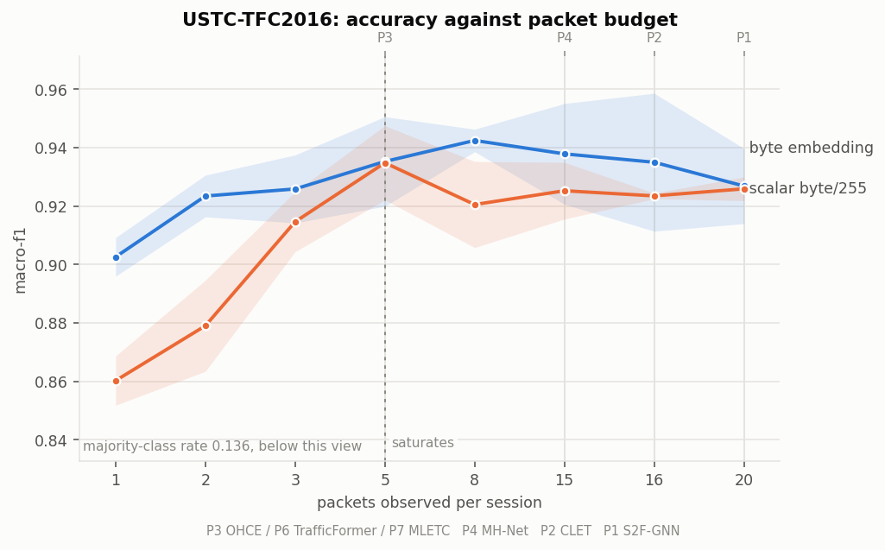

*Accuracy against packet budget.*

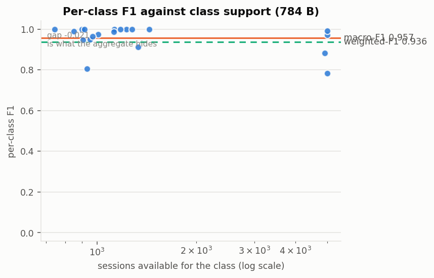

*Per-class F1 against class support, with the macro/weighted gap.*

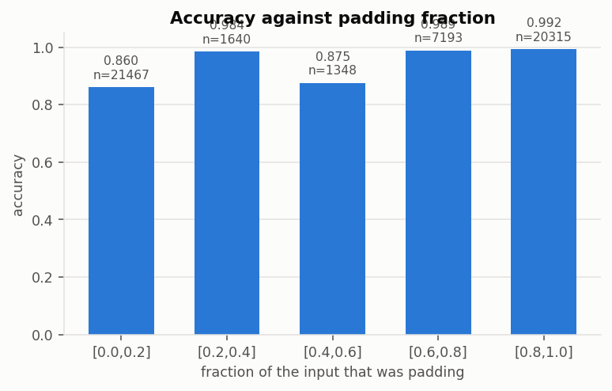

*Accuracy against padding fraction.*


*What the padding control actually measures.*


*Fixed depth against the adaptive exit policy.*


*What masking the port bytes costs, against the ports-only probe and the majority-class rate.*

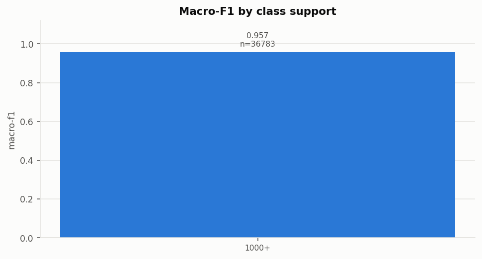

*Macro-F1 by class support.*

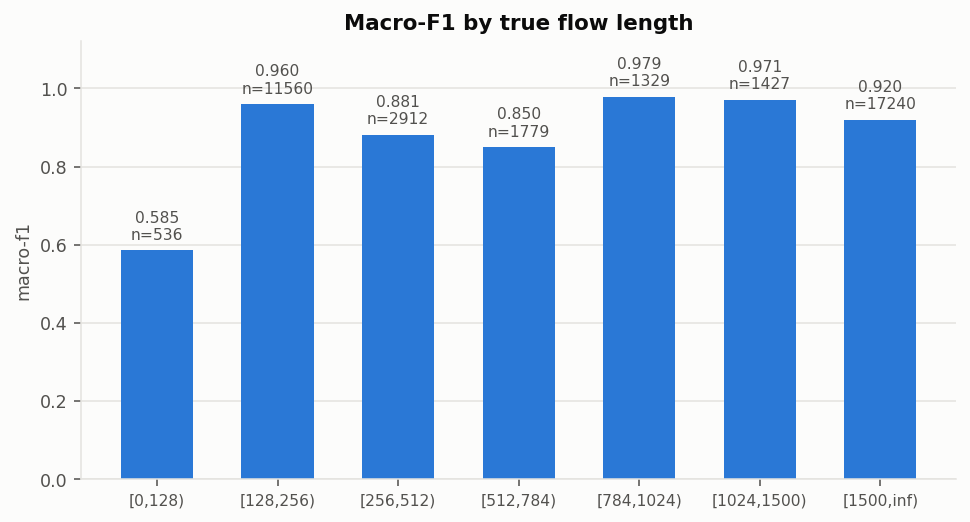

*Macro-F1 by true flow length.*

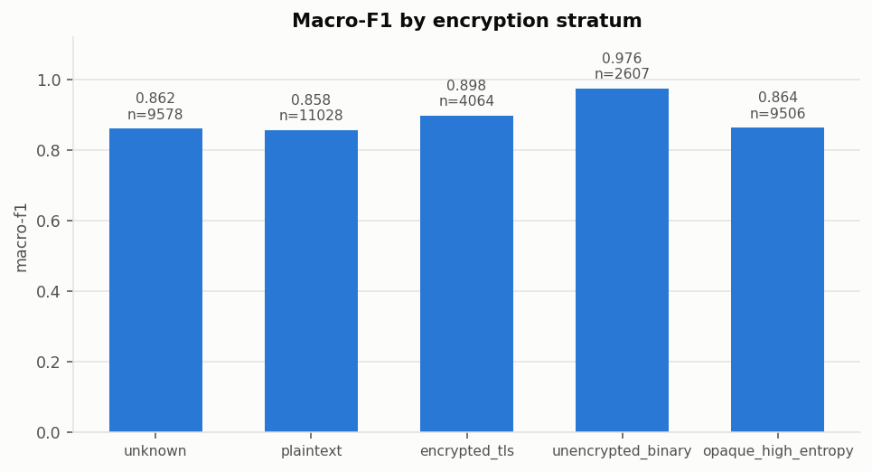

*Macro-F1 by encryption stratum.*


### 5. Comparison with existing research

```
Comparison on USTC-TFC2016

method                   year  budget                         acc  macroF1
--------------------------------------------------------------------------
P3 OHCE                  2026  5 packets                   0.9438       --
      not comparable: different session filtering
      not comparable: reports accuracy but not macro-F1
      open-set setting; flows under 5 packets discarded entirely

P7 MLETC                 2025  5 packets x 100 bytes       0.9902   0.9926
      broadly comparable: budget, class scheme and anonymisation align; preprocessing and splits still differ

P8 MFF                   2025  1024 bytes                  0.9999       --
      not comparable: reports accuracy but not macro-F1
      about 70% of USTC-TFC sessions are padded at this budget

P10 TransECA-Net         2025  784 bytes                   0.9825       --
      not comparable: different class scheme (10 against 20)
      not comparable: reports accuracy but not macro-F1
      ten benign classes only, used for generalisation

--------------------------------------------------------------------------
this work (wang1d)       2026  512B                        0.9726   0.9731
      identifiers removed, and the removal verified by a positive control

Read with care. These figures were produced under different preprocessing, different class schemes and different splits, and
several of the papers do not say whether identifier fields were removed. P5 measured that removing them costs ET-BERT 0.45
accuracy, so a retained-identifier number and an anonymised number are not measuring the same task. The budgets, by contrast,
are directly comparable, and locating them on our own sweep is the point of the exercise.
```


### 6. Ablation studies

#### Step 10(i): representation, matched budget

```

variant                         macro-F1      sd    delta  verdict
1D sequence                       0.9564  0.0018  (reference)
2D byte image 28x28               0.9595  0.0095  +0.0031  inconclusive
1D Deep Packet                    0.9615  0.0209  +0.0051  inconclusive
```

#### Step 10(ii): layer scope

```

variant                         macro-F1      sd    delta  verdict
all layers                        0.9564  0.0018  (reference)
headers only                      0.9531  0.0083  -0.0033  inconclusive
payload only                      0.9018  0.0012  -0.0546  worse
```

#### Step 10(iv): early-exit supervision

```

variant                         macro-F1      sd    delta  verdict
all heads supervised              0.9714  0.0129  (reference)
terminal head only                0.9794  0.0074  +0.0080  inconclusive
```

#### Step 10(iii): granularity

Bidirectional sessions against unidirectional flows at 784B. The unit of analysis is fixed when the store is written, so this is the one ablation that needs a second pass over the captures rather than another slice.

| unit | macro-F1 | accuracy | units | test | median true length |
|---|---|---|---|---|---|
| bidirectional session | 0.9500 ± 0.0304 | 0.9649 ± 0.0246 | 353,496 | 51,963 | 474 B |
| unidirectional flow | 0.9545 ± 0.0131 | 0.9645 ± 0.0183 | 454,230 | 67,071 | 288 B |

Difference +0.0045 macro-F1 against 0.0304 of seed noise. Verdict: **inconclusive**.

*One session becomes up to two flows, so the two settings differ in sample count as well as in granularity; the comparison is between settings, not between equally-sized datasets.* Here that is 353,496 units against 454,230, and a median true length of 474 B against 288 B. The flow setting is therefore the less truncated one, so granularity and effective budget move together. With the difference inside seed noise there is nothing to attribute, and this design could not have separated them had there been.

#### Port dependence (Step 11, the retained-field control)

Phase 2 Step 3c retained ports, citing P1's ablation, and deferred the consequence to Step 11. Two measurements answer it, and they point in different directions, so both are reported.

A probe trained on nothing but the four port bytes reaches **0.7509** accuracy against a 0.1359 majority-class rate: a strong shortcut is available. But masking those bytes in every packet costs almost nothing above the smallest budget.

| budget | with ports | ports masked | lost | conclusive |
|---|---|---|---|---|
| 64B | 0.9188 ± 0.0047 | 0.8760 ± 0.0088 | +0.0428 | yes |
| 128B | 0.9426 ± 0.0070 | 0.9476 ± 0.0027 | -0.0050 | no |
| 256B | 0.9652 ± 0.0041 | 0.9699 ± 0.0063 | -0.0047 | no |
| 512B | 0.9832 ± 0.0016 | 0.9652 ± 0.0256 | +0.0181 | no |
| 784B | 0.9564 ± 0.0018 | 0.9463 ± 0.0173 | +0.0101 | no |
| 1500B | 0.9367 ± 0.0142 | 0.9358 ± 0.0048 | +0.0009 | no |

So port information is *redundantly encoded* rather than load-bearing: available as a shortcut, but masking it changes the result by more than seed noise only at 64B. Above 64B the difference is inside noise, so the budget curve there is not a port artifact.

#### Padding controls

| control | macro-F1 | change against zero padding |
|---|---|---|
| zero | 0.9351 ± 0.0067 |  |
| embed | 0.9489 ± 0.0069 | +0.0138 |
| mask | 0.9553 ± 0.0176 | +0.0202 |
| convmask | 0.9399 ± 0.0053 | +0.0048 |
| length_balanced | 0.7907 ± 0.0133 | -0.1444 |

Moving from the scalar input to an embedding with a PAD symbol changes two things at once. Split: **representation +0.0138**, **padding symbol +0.0065** (seed noise 0.0176; the padding effect is inside it).


### 7. Results analysis and discussion

Two stratified runs are reported. The sweep used a 5,000-per-class cap to control runtime and the corpus's 14x imbalance, but that cap applies to the test set too and flattens exactly the minority-class behaviour Gap 2 concerns. The uncapped run below restores the native class distribution; the capped figures are in `e3_stratified_wang1d_784B.json`.

#### What the aggregate conceals

Overall at 784B: accuracy 0.9409, macro-F1 0.9245, weighted-F1 0.9378. The macro-to-weighted gap is **+0.0133**.

#### By true flow length

| stratum | n | accuracy | macro-F1 |
|---|---|---|---|
| [0,128) | 557 | 0.9677 | 0.7072 |
| [128,256) | 23240 | 0.9947 | 0.9280 |
| [256,512) | 4246 | 0.9270 | 0.9232 |
| [512,784) | 2434 | 0.8398 | 0.8548 |
| [784,1024) | 1650 | 0.9897 | 0.9779 |
| [1024,1500) | 1472 | 0.9891 | 0.9618 |
| [1500,inf) | 18364 | 0.8803 | 0.9113 |

#### By class support

| stratum | n | accuracy | macro-F1 |
|---|---|---|---|
*bins derived from the corpus: USTC-TFC2016's smallest class holds ~5,000 sessions, so the sub-50-session regime the review identified in P2 does not exist here and cannot be tested on this corpus*

| 0-6172 | 4315 | 0.9103 | 0.9465 |
| 6173-7487 | 4980 | 0.9054 | 0.9287 |
| 7488-9048 | 6138 | 0.9871 | 0.9935 |
| 9049-83696 | 36530 | 0.9416 | 0.9274 |

#### By encryption stratum

| stratum | n | accuracy | macro-F1 |
|---|---|---|---|
| unknown | 15259 | 0.9778 | 0.8581 |
| plaintext | 18737 | 0.9756 | 0.8869 |
| encrypted_tls | 4064 | 0.9050 | 0.8177 |
| unencrypted_binary | 3271 | 0.9936 | 0.8229 |
| opaque_high_entropy | 10632 | 0.8243 | 0.9002 |

#### The adaptive policy

the adaptive policy matches the best fixed head's macro-F1 (0.9716 at 512 bytes) while reading 144 bytes on average, 28% of the fixed cost

At tau=0.99 the policy reads 144 bytes on average against 512 for the best fixed head, 28% of the cost.

#### Representation

Best macro-F1 with the embedding input 0.9731, with the scalar byte/255 input 0.9398, a difference of +0.0332. The budget curve therefore has no meaning independent of the representation it was measured with, which is a caution about comparing budget choices across papers that differ in this respect.

#### Against the Phase 1 research gaps

Each gap below is answered on USTC-TFC2016 alone. Where the two corpora disagree, the cross-corpus reading is in `../README.md`; a gap answered on one corpus is not answered in general.

##### Gap 1: the observation budget is inherited, not measured

The byte sweep saturates at **512B**: no larger budget beats it at all: the best of them, 784B, is 0.0167 macro-F1 *worse*.
The packet sweep saturates at **5P**: the best larger budget, 8P, adds only 0.0072 macro-F1, inside the 0.0236 seed noise.

Of the 6 budgets the reviewed papers use, **6 sit at or past the saturation point**:

| paper budget | paper | at or past saturation |
|---|---|---|
| 784B | P10 TransECA-Net | yes |
| 1024B | P8 MFF | yes |
| 5P | P3 OHCE / P6 TrafficFormer / P7 MLETC | yes |
| 15P | P4 MH-Net | yes |
| 16P | P2 CLET | yes |
| 20P | P1 S2F-GNN | yes |

None of those papers justifies its budget by a sweep; the value is carried over from earlier work. What that carried-over value actually costs is settled below by a paired test, which measures the same comparison per session rather than per run.

The paired test compares 512B against 784B on the same 2,582 sessions that the two models answered differently (p = 0). It favours **512B**, the smaller budget, by 2,488 sessions to 94. Reading on to 784B does not merely stop helping, it **actively hurts**, and reliably so.

That is a stronger statement than the seed-noise verdict can make. A budget past saturation is not a harmless over-collection: the extra bytes are mostly padding at these lengths, and training on them costs accuracy as well as collection cost.

##### Gap 2: minority and short classes failing inside aggregate metrics

The concealment gap is **+0.0133** (weighted-F1 0.9378 against macro-F1 0.9245). 
A weighted average therefore reports 0.0133 more F1 than the per-class picture supports.

The worst class is `Skype`: **F1 0.734, recall 0.580** on 914 test sessions.
 No class comes close to the 0.05 line used to flag an outright failure, so the specific failure mode P2 and P10 exhibit does not reproduce on this corpus.

By class support, the smallest-support classes score *higher*: 0-6172 at macro-F1 0.9465 against 9049-83696 at 0.9274.

That is the opposite of the literature's framing, and it is why the split-strategy caveat below matters: class support and split strategy are confounded on this corpus, so this ordering is not safe to read as a statement about support.

*Measured on the uncapped split. The capped run flattens exactly the minority-class behaviour this gap is about, so it is reported beside it rather than instead of it.*

##### Gap 3: how much of the corpus is actually encrypted

This is reported as two bounds rather than one number, because the tagger resolves only part of the corpus. **41.3%** of sessions are definitely *not* encrypted: plaintext, or a recognisable unencrypted binary protocol. **7.8%** carry a TLS handshake that could be parsed and confirmed. The remainder is unresolved: a session with no readable handshake may be encrypted, tunnelled, or simply too short to tell.

So the encrypted share lies between **7.8%** and **58.7%**. The useful half of that is the lower bound: only 7.8% of this corpus is *confirmed* encrypted traffic, which is less than a paper describing it as an encrypted-traffic benchmark implies. The upper bound is what stops this being a stronger claim. P5's figure of around 95-99% unencrypted is neither reproduced nor contradicted here, because the method used cannot resolve the 28.7% it leaves unknown.

Of the 6710 handshakes that were parsed, **95.2% negotiate a suite that is now deprecated**. So even the confirmed-encrypted portion does not resemble traffic a classifier would meet today: its ciphers predate the deployment it would be used in, and a model tuned on them is tuned on a handshake distribution that no longer exists.


| budget | sessions padded rather than truncated |
|---|---|
| 64B | 0.0% |
| 128B | 0.8% |
| 256B | 39.9% |
| 512B | 51.2% |
| 784B | 57.6% |
| 1024B | 60.3% |
| 1500B | 64.4% |

The padding column is the other half of the gap. At the two byte budgets the reviewed papers use, 57.6%-60.3% of sessions are shorter than the budget, so for those sessions part of what the model reads is padding rather than traffic. No reviewed paper reports this fraction.

##### Gap 4: shortcut learning and the positive control

The gate holds. A probe reading only the anonymised MAC and IP byte positions reaches 0.1351 accuracy against a 0.1359 majority-class rate, below chance, so anonymisation left no usable identifier signal. Gate verdict: **passed**.

The same positions *before* anonymisation reach 0.3851, which is how much identifier shortcut the anonymisation destroyed. A pipeline that skipped that step would have had that much free accuracy available, and no reviewed paper runs this control.

Ports are the retained-field risk: a ports-only probe reaches 0.7509.
 Masking those bytes costs the full model at most **+0.0428** macro-F1, at 64B, and that one is outside seed noise.
 At every other budget the cost is no more than +0.0181.
 So on the averaged measurement the information looks redundantly encoded rather than load-bearing: the shortcut is available, and the model does not obviously depend on it once it can see past the header.


A paired test at 512B on the same 2,384 sessions the two settings disagreed about gives p = 0, favouring **ports retained** by 2,277 sessions to 107 (0.9895 against 0.9477 accuracy). At this budget the ports are doing real work for a given trained model.
 Measured over three seeds at the same budget, masking costs +0.0181 macro-F1 against 0.0256 of seed noise, which is **inside** it: the per-session effect is real for that run and does not survive reseeding.
 The masked arm's spread is driven by one run: seed 0 scores 0.9361 where the others reach 0.9841 and 0.9754. The paired test above used seed 0, so it measured that run.

That is the clearest lesson in this report about method. McNemar can be overwhelmingly significant, with p numerically zero here, for a difference that simply does not reappear when the model is retrained with another seed. A paired test says something true about two particular trained models; it says nothing on its own about the setting that produced them. Reporting it without the seed-noise band beside it would have turned one unlucky run into a finding.

This is why both instruments are reported. A ports-only probe alone would condemn the design; a single paired test alone would convict it on one run; a small averaged drop alone would clear it without showing the work.

On padding specifically, the apparent benefit of a PAD symbol decomposes into **+0.0138** from the representation and **+0.0065** from the padding symbol itself, against 0.0176 of seed noise.
 **Neither clears that bar**, so on this corpus the control separates nothing: the combined change is small enough that three seeds cannot tell its two halves apart. That is a null result, not support for either attribution, and it is why the same measurement on the other corpus, where the representation term is an order of magnitude larger, carries the claim.

The length-balanced control equalises the flow-length distribution across the 7 of 20 classes that occupy every length bin, leaving **168 test sessions** and a 0.1429 within-set chance rate. It asks whether anything survives when flow length can no longer separate the classes.
 It scores macro-F1 **0.7907** (std 0.0133, 0.8214 accuracy).

That is well clear of the 0.1429 chance rate, so on this corpus **content still separates the classes with length held fixed**. The budget curve is not simply a length curve wearing a different label.

Two things bound how far that goes. The test set is 168 sessions, so the effect size is imprecise even where the direction is unambiguous. And the retained classes are a biased subset by construction: the ones whose lengths overlap every other class, which is to say the ones least likely to have been separable by length in the first place.

*Retained: `Geodo`, `Htbot`, `Miuref`, `Neris`, `Nsis-ay`, `Shifu`, `Virut`. Excluded for not spanning all bins: `Cridex`, `Tinba`, `Zeus`, `BitTorrent`, `Facetime`, `FTP`, `Gmail`, `MySQL`, `Outlook`, `Skype`, `SMB`, `Weibo`, `WorldOfWarcraft`.*

##### The limitation that cuts across all four

**19 of 20 classes on this corpus are split temporally, not group-wise.** A temporal split draws train and test from the same capture and separates them only in time. It is a fallback, for two distinct reasons:

- the class occupies fewer than three capture files, so whole files cannot be held out at all; or
- a group split was attempted and left one of the three splits empty, because the class's files are too unevenly sized to divide 70/15/15.

*single capture file*: `BitTorrent`, `Cridex`, `FTP`, `Facetime`, `Geodo`, `Gmail`, `Htbot`, `Miuref`, `MySQL`, `Neris`, `Nsis-ay`, `Outlook`, `SMB`, `Shifu`, `Skype`, `Tinba`, `Virut`, `WorldOfWarcraft`, `Zeus`.

This is a property of the corpus, not a choice: the captures do not exist to split any other way. But it means per-class scores are not on one scale, and every number above that compares classes is confounded with it. It also sets a ceiling on how much of the headline accuracy should be believed to transfer to unseen captures, the usual deployment case, and the one a random within-capture split measures least well.


---

Reproduce with the commands in `README.md`. Every figure and table above is generated from the JSON in this directory by `scripts/make_report.py`.

## Appendix B: full report, ISCX VPN-nonVPN

### 1-2. Implementation, dataset and experimental setup

#### Changes from the Phase 2 methodology

7 changes, each forced by something found while implementing or running. Lifted from `PHASE3.md`, which remains the requirement map.

1. **An input-representation axis was added.** Phase 2 Step 4 specified raw
   bytes normalised to [0, 1]. Implementation showed that this representation
   cannot match exact byte values (after scaling, two byte values one apart
   differ by 0.004) and on a corpus with a cue planted past byte 780 it
   plateaus at 0.492 macro-F1 while a learned byte embedding reaches 1.000.
   Since the budget curve is the study's primary instrument, and its shape
   depends on this choice, the representation is now swept as a variable
   rather than fixed. `--compare-representations` runs both.

2. **The padding control gained an attribution arm.** Step 11(ii) proposed
   comparing zero padding against a masked embedding. Those differ in two
   ways at once, and on synthetic data the combined effect is +0.519 macro-F1
   of which the padding symbol contributes +0.000. A fourth mode (`embed`:
   embedding input, ordinary zero padding) was added so the two are separable.

3. **The leakage control was split into three probes.** Step 11(i) described
   training on "the fields that were supposed to be anonymised", which is
   ambiguous. It is now: `id_positions` (those byte positions read from the
   *anonymised* store, the halt condition, which must sit at chance), `ident`
   (the same positions *before* anonymisation, context, expected to be high),
   and `ports` (the fields Step 3c deliberately retains, a reported risk, not a
   gate).

4. **The adaptive classifier's encoder is causal.** Step 5 specified early-exit
   heads at byte depths but not how to guarantee a head's output depends only
   on bytes before its depth. Without that guarantee the accuracy-per-byte
   frontier is meaningless. The encoder uses dilated causal convolutions and
   per-position normalisation; `tests/test_models_causality.py` asserts that
   head *k* returns bit-identical logits from a truncated and a full input.

5. **The split is group-wise *where the corpus allows it*, and temporal where
   it does not.** Step 3f specified a group-wise split with whole capture
   files held out. On real data that is often impossible: a class whose
   sessions come from fewer than three capture files has no files to hold out,
   and a class whose files are very unevenly sized can leave one of the three
   splits empty. `make_split` therefore falls back per class to a temporal
   split on first-packet timestamp, and records which strategy each class got
   so the reports can carry the caveat. This matters more than it sounds: 19
   of 20 USTC classes and 5 of 11 ISCX classes end up temporal, meaning train
   and test come from the same capture, the easier problem. It is a property
   of these corpora rather than a choice, but it bounds what the headline
   numbers mean, and the two corpora cannot be compared without it.

6. **The split strategy became an experiment rather than a caveat.** Change 5
   left the study's largest limitation unquantified: the corpus that scores
   higher is also the one split the easier way, and nothing in the Phase 2
   plan could separate those. Six ISCX classes have enough capture files to be
   split either way, which makes the question answerable within one corpus.
   `run_split_strategy.py` holds the classes, budget, model, epochs, seeds
   *and per-class split sizes* fixed and varies only where the train/test
   boundary falls: whole capture files, a timestamp inside those captures, or
   nothing. Matching the sizes is what turns it from a third confound into a
   measurement. The result is that a random within-capture split is worth
   +0.3782 macro-F1 over a group-wise one, while the temporal fallback this
   study actually uses is not measurably worse than group-wise (+0.0431
   against 0.0510 of seed noise). This was not in the Phase 2 plan; it exists
   because the limitation was worth measuring rather than conceding.

7. **The model family became a controlled variable.** Phase 2 fixed the
   classifier to the byte-image and byte-sequence CNNs the baselines come
   from. Every one of the twelve reviewed papers uses a transformer or a graph
   network instead, so a saturation point measured only under convolution
   could not be claimed to say anything about the architectures the field
   actually uses. A byte-level transformer (`models.ByteTransformer`: patch
   tokenisation by strided convolution, four pre-norm encoder layers, a
   key-padding mask) now carries the whole E2 sweep on ISCX with the store,
   split manifest, schedule and seeds held fixed. The two families are not
   separable: peaks of 0.5245 ± 0.0208 and 0.5195 ± 0.0379, saturating at the
   same packet budget. So the budget finding is a property of the data rather
   than of the convolutional stack. The transformer is trained from scratch
   and is not comparable to the pre-trained models it is modelled on; that is
   recorded as a limitation rather than worked around.


#### The leakage gate

Before any result is reported, the same architecture is trained on restricted views of the input. The gate is the first row: those byte positions are read out of the *anonymised* store, so a score above the majority-class rate would mean the anonymisation did not land.

| probe | input | accuracy | majority-class rate |
|---|---|---|---|
| **gate** | MAC/IP positions, after anonymisation | 0.1095 ± 0.0000 | 0.2258 |
| context | the same positions, before anonymisation | 0.5330 ± 0.0369 | 0.2258 |
| risk | the retained port bytes | 0.3019 ± 0.0337 | 0.2258 |

**Gate passed** (excess over chance -0.1164, margin 0.1).

The port probe scores above chance. Ports are retained deliberately (Phase 2 Step 3c, following P1's ablation), so this is not a gate failure, but it means some of the headline accuracy is port information rather than traffic content and must be read that way.


### 3. Baseline evaluation

| baseline | budget | accuracy | macro-F1 | weighted-F1 |
|---|---|---|---|---|
| Wang et al. 2017 byte image (28×28) | 784B | 0.4523 ± 0.0326 | 0.5108 ± 0.0099 | 0.4132 ± 0.0301 |
| Wang et al. 2017 1D-CNN | 784B | 0.4419 ± 0.0265 | 0.5245 ± 0.0208 | 0.4124 ± 0.0294 |
| Deep Packet (Lotfollahi et al. 2020) | 1500B | 0.4327 ± 0.0545 | 0.5018 ± 0.0258 | 0.4006 ± 0.0446 |

#### Paired significance tests

A seed-noise verdict asks whether a difference exceeds run-to-run variation. For comparisons scored on the *same* test sessions, McNemar's exact test asks a sharper question: whether one setting reliably beats the other on these sessions. Both are reported, because they can disagree and the disagreement is informative.

| pair | A | B | discordant B→A / A→B | p | significant |
|---|---|---|---|---|---|
| saturation | 256B 0.3939 | 784B 0.4136 | 254 / 174 | 0.000129 | **yes** |
| ports | ports retained 0.3939 | ports masked 0.3981 | 234 / 217 | 0.451 | no |

*Seed 0, 4,047 paired test sessions. The granularity ablation is deliberately absent: sessions and flows are different units, so the test sets differ in size and McNemar does not apply.*


### 4. Graphical results

The study's primary result. Architecture, optimiser, schedule, split and seeds are held constant; only the number of bytes the model may read changes.

| byte budget | macro-F1 | accuracy | mean padding fraction |
|---|---|---|---|
| 64B | 0.4643 ± 0.0158 | 0.3858 ± 0.0272 | 0.002 |
| 128B | 0.5031 ± 0.0212 | 0.4191 ± 0.0549 | 0.021 |
| 256B | 0.5061 ± 0.0191 | 0.4344 ± 0.0378 | 0.244 |
| 512B | 0.5078 ± 0.0096 | 0.4062 ± 0.0078 | 0.478 |
| 784B | 0.5245 ± 0.0208 | 0.4419 ± 0.0265 | 0.587 |
| 1024B | 0.5092 ± 0.0326 | 0.4365 ± 0.0278 | 0.639 |
| 1500B | 0.5083 ± 0.0288 | 0.4141 ± 0.0373 | 0.701 |

**Saturation:** 256B: no larger budget improves on it by more than seed noise (0.0326).

| packet budget | macro-F1 | accuracy | tensor width |
|---|---|---|---|
| 1P | 0.4644 ± 0.0070 | 0.4073 ± 0.0362 | 192 |
| 2P | 0.5103 ± 0.0320 | 0.4283 ± 0.0523 | 512 |
| 3P | 0.5005 ± 0.0290 | 0.4088 ± 0.0619 | 512 |
| 5P | 0.5188 ± 0.0314 | 0.4346 ± 0.0502 | 832 |
| 8P | 0.5095 ± 0.0353 | 0.4238 ± 0.0538 | 1664 |
| 15P | 0.5175 ± 0.0275 | 0.4346 ± 0.0366 | 2048 |
| 16P | 0.5252 ± 0.0322 | 0.4507 ± 0.0476 | 2048 |
| 20P | 0.5124 ± 0.0309 | 0.4172 ± 0.0540 | 2048 |

**Saturation (packets):** 2P.


*Accuracy against byte budget, with the reviewed papers' choices marked.*

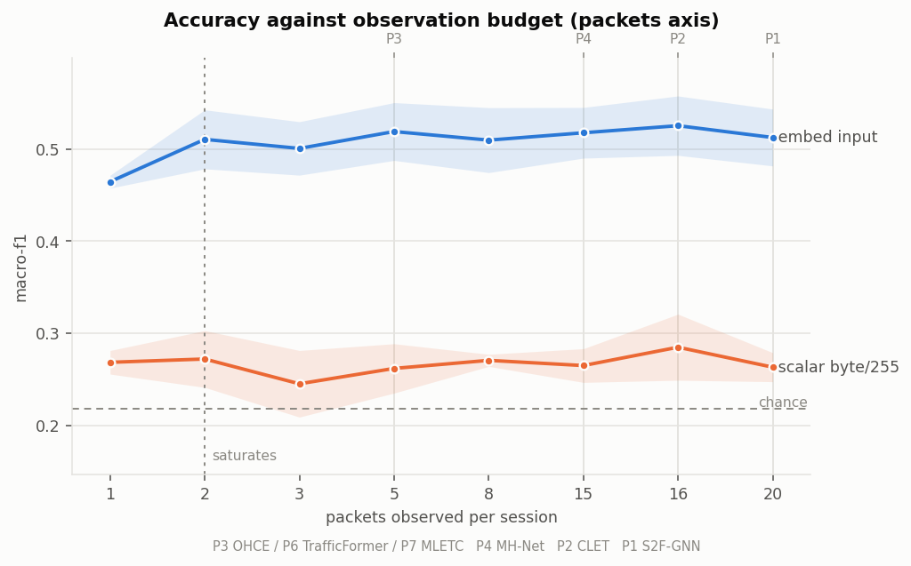

*Accuracy against packet budget.*

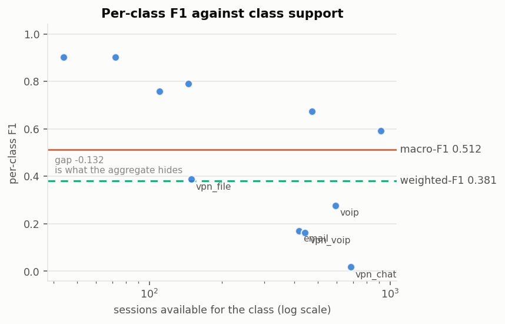

*Per-class F1 against class support, with the macro/weighted gap.*

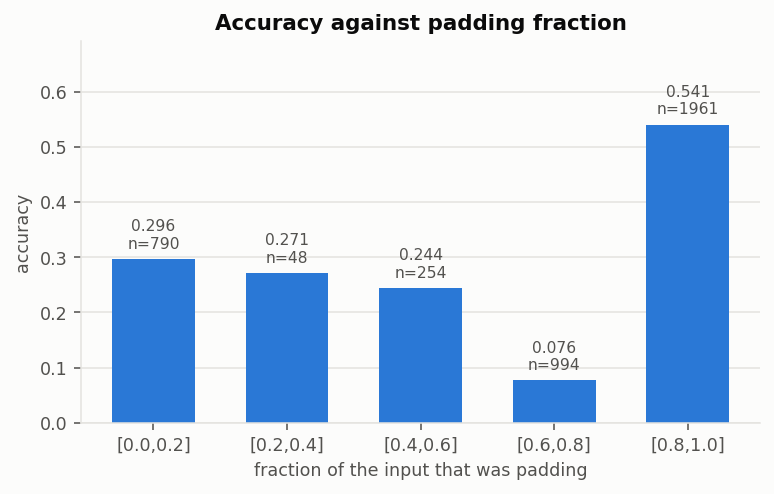

*Accuracy against padding fraction.*


*What the padding control actually measures.*


*Fixed depth against the adaptive exit policy.*


*What masking the port bytes costs, against the ports-only probe and the majority-class rate.*

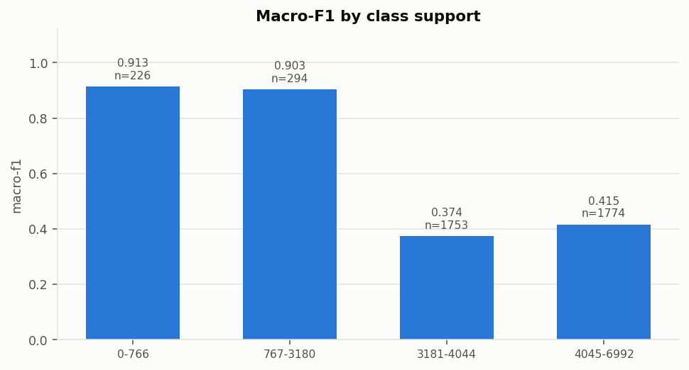

*Macro-F1 by class support.*

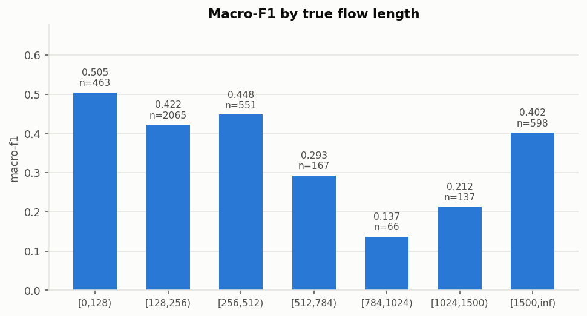

*Macro-F1 by true flow length.*

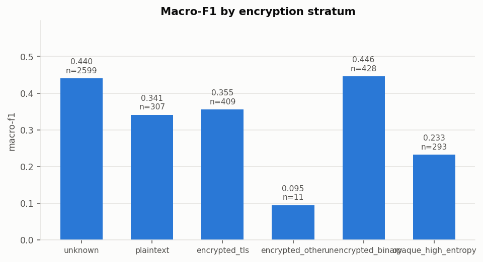

*Macro-F1 by encryption stratum.*


### 5. Comparison with existing research

```
Comparison on iscx

method                   year  budget                         acc  macroF1
--------------------------------------------------------------------------
P1 S2F-GNN               2026  20 packets, 10 x 0.1 s wi…  0.9326       --
      not comparable: does not state whether identifier fields were removed
      not comparable: reports accuracy but not macro-F1
      accuracy at 20% labels; the headline claim is few-shot, not full-label

P1 S2F-GNN               2026  20 packets, 5% labels           --   0.8754
      not comparable: does not state whether identifier fields were removed
      F1 at 5% labels

P2 CLET                  2026  16 packets, header descri…  0.8861   0.8280
      not comparable: different class scheme (14 against 11)
      not comparable: does not state whether identifier fields were removed
      not comparable: different session filtering
      DNS and SSDP removed, leaving 4,511 of 13,520 sessions; AIM 0% and SFTP 50% inside this macro-F1

P4 MH-Net                2025  15 packets, flow level      0.9942   0.9941
      not comparable: different class scheme (6 against 11)
      flow level; removing the 8-bit view collapses F1 to 0.1702

P4 MH-Net                2025  15 packets, packet level    0.9768   0.9766
      not comparable: different class scheme (6 against 11)
      packet level

P5 SoK (ET-BERT)         2025  varies by occlusion         0.9600       --
      not comparable: identifier fields retained, which P5 shows is worth up to 0.45 accuracy on its own
      not comparable: different session filtering
      not comparable: reports accuracy but not macro-F1
      0.96 with identifier fields present, 0.51 with them removed

P5 SoK (YaTC)            2025  varies by occlusion         0.9000       --
      not comparable: identifier fields retained, which P5 shows is worth up to 0.45 accuracy on its own
      not comparable: reports accuracy but not macro-F1
      0.90 with identifiers, 0.62 without; encrypted payload alone 0.30

P7 MLETC                 2025  5 packets x 100 bytes       0.9875   0.9880
      not comparable: different class scheme (6 against 11)
      budget chosen to fit a 512-token ceiling, by the authors' own account

P8 MFF                   2025  1024 bytes                  0.9961       --
      not comparable: different class scheme (12 against 11)
      not comparable: reports accuracy but not macro-F1
      about 87% of ISCX-VPN sessions fall below this budget and are padded

P9 Dual Embedding + GNN  2025  fixed packet count          0.9670   0.9600
      not comparable: identifier fields retained, which P5 shows is worth up to 0.45 accuracy on its own
      retains source and destination IP addresses and ports as inputs

P10 TransECA-Net         2025  784 bytes                   0.9765       --
      not comparable: different class scheme (12 against 11)
      not comparable: reports accuracy but not macro-F1
      per-class far weaker than the headline: File 93.56%, VoIP 92.20%

P11 CL-MetaFlow          2025  no payload used                 --   0.6200
      not comparable: different class scheme (17 against 11)
      5-way 5-shot; far lower than closed-world figures, by design

P12 Stacked ensembles    2025  88 flow-level features      0.9930       --
      not comparable: different class scheme (6 against 11)
      not comparable: does not state whether identifier fields were removed
      not comparable: reports accuracy but not macro-F1
      flow statistics, not raw bytes; fitting the scaler on all data inflates accuracy from 0.9949 to 0.9960

--------------------------------------------------------------------------
this work (wang1d)       2026  784B                        0.4419   0.5245
      identifiers removed, and the removal verified by a positive control

Read with care. These figures were produced under different preprocessing, different class schemes and different splits, and
several of the papers do not say whether identifier fields were removed. P5 measured that removing them costs ET-BERT 0.45
accuracy, so a retained-identifier number and an anonymised number are not measuring the same task. The budgets, by contrast,
are directly comparable, and locating them on our own sweep is the point of the exercise.
```


### 6. Ablation studies

#### Step 10(i): representation, matched budget

```

variant                         macro-F1      sd    delta  verdict
1D sequence                       0.5245  0.0208  (reference)
2D byte image 28x28               0.5108  0.0099  -0.0137  inconclusive
1D Deep Packet                    0.5064  0.0050  -0.0181  inconclusive
```

#### Step 10(ii): layer scope

```

variant                         macro-F1      sd    delta  verdict
all layers                        0.5245  0.0208  (reference)
headers only                      0.4857  0.0635  -0.0388  inconclusive
payload only                      0.4268  0.0039  -0.0978  worse
```

#### Step 10(iv): early-exit supervision

```

variant                         macro-F1      sd    delta  verdict
all heads supervised              0.5440  0.0383  (reference)
terminal head only                0.5338  0.0162  -0.0103  inconclusive
```

#### Step 10(iii): granularity

Bidirectional sessions against unidirectional flows at 784B. The unit of analysis is fixed when the store is written, so this is the one ablation that needs a second pass over the captures rather than another slice.

| unit | macro-F1 | accuracy | units | test | median true length |
|---|---|---|---|---|---|
| bidirectional session | 0.5234 ± 0.0275 | 0.4365 ± 0.0647 | 31,855 | 4,047 | 274 B |
| unidirectional flow | 0.4259 ± 0.0111 | 0.3183 ± 0.0113 | 50,488 | 7,668 | 159 B |

Difference -0.0976 macro-F1 against 0.0275 of seed noise. Verdict: **session better**.

*One session becomes up to two flows, so the two settings differ in sample count as well as in granularity; the comparison is between settings, not between equally-sized datasets.* Here that is 31,855 units against 50,488, and a median true length of 274 B against 159 B. The flow setting is therefore the less truncated one, and it still lost. That matters: truncation would have pushed the result the other way, so it cannot explain the session advantage. Pairing the two directions carries information that reading them separately does not, and the confound in this design works against that conclusion rather than for it.

#### Port dependence (Step 11, the retained-field control)

Phase 2 Step 3c retained ports, citing P1's ablation, and deferred the consequence to Step 11. Two measurements answer it, and they point in different directions, so both are reported.

A probe trained on nothing but the four port bytes reaches **0.3019** accuracy against a 0.2258 majority-class rate: a strong shortcut is available. But masking those bytes in every packet costs almost nothing above the smallest budget.

| budget | with ports | ports masked | lost | conclusive |
|---|---|---|---|---|
| 64B | 0.4643 ± 0.0158 | 0.4655 ± 0.0194 | -0.0012 | no |
| 128B | 0.5031 ± 0.0212 | 0.5083 ± 0.0253 | -0.0052 | no |
| 256B | 0.5061 ± 0.0191 | 0.5084 ± 0.0128 | -0.0023 | no |
| 784B | 0.5245 ± 0.0208 | 0.5205 ± 0.0146 | +0.0040 | no |
| 1500B | 0.5083 ± 0.0288 | 0.5063 ± 0.0239 | +0.0020 | no |

So port information is *redundantly encoded* rather than load-bearing: at no budget in the sweep does masking the port bytes change macro-F1 by more than seed noise. The budget curve is not a port artifact on this corpus.

#### Padding controls

| control | macro-F1 | change against zero padding |
|---|---|---|
| zero | 0.2684 ± 0.0373 |  |
| embed | 0.5092 ± 0.0326 | +0.2408 |
| mask | 0.5178 ± 0.0183 | +0.2494 |
| convmask | 0.3001 ± 0.0235 | +0.0317 |
| length_balanced | 0.1106 ± 0.0319 | -0.1578 |

Moving from the scalar input to an embedding with a PAD symbol changes two things at once. Split: **representation +0.2408**, **padding symbol +0.0086** (seed noise 0.0373; the padding effect is inside it).


### 7. Results analysis and discussion

Two stratified runs are reported. The sweep used a 5,000-per-class cap to control runtime and the corpus's 14x imbalance, but that cap applies to the test set too and flattens exactly the minority-class behaviour Gap 2 concerns. The uncapped run below restores the native class distribution; the capped figures are in `e3_stratified_wang1d_784B.json`.

#### What the aggregate conceals

Overall at 784B: accuracy 0.4013, macro-F1 0.5110, weighted-F1 0.3798. The macro-to-weighted gap is **-0.1313**.

#### By true flow length

| stratum | n | accuracy | macro-F1 |
|---|---|---|---|
| [0,128) | 463 | 0.6285 | 0.4491 |
| [128,256) | 2065 | 0.3191 | 0.3948 |
| [256,512) | 551 | 0.5354 | 0.5109 |
| [512,784) | 167 | 0.2515 | 0.2120 |
| [784,1024) | 66 | 0.4091 | 0.2188 |
| [1024,1500) | 137 | 0.1971 | 0.2189 |
| [1500,inf) | 598 | 0.4732 | 0.4235 |

#### By class support

| stratum | n | accuracy | macro-F1 |
|---|---|---|---|
| 0-766 | 226 | 0.8407 | 0.9074 |
| 767-3180 | 294 | 0.8401 | 0.9033 |
| 3181-4044 | 1753 | 0.2886 | 0.4096 |
| 4045-6992 | 1774 | 0.3839 | 0.3737 |

#### By encryption stratum

| stratum | n | accuracy | macro-F1 |
|---|---|---|---|
| unknown | 2599 | 0.3536 | 0.4258 |
| plaintext | 307 | 0.7068 | 0.3857 |
| encrypted_tls | 409 | 0.5208 | 0.3809 |
| encrypted_other | 11 | 0.1818 | 0.1667 |
| unencrypted_binary | 428 | 0.5187 | 0.4961 |
| opaque_high_entropy | 293 | 0.1741 | 0.2253 |

#### The adaptive policy

the adaptive policy matches the best fixed head's macro-F1 (0.5474 at 512 bytes) while reading 116 bytes on average, 23% of the fixed cost

At tau=0.70 the policy reads 116 bytes on average against 512 for the best fixed head, 23% of the cost.

#### Representation

Best macro-F1 with the embedding input 0.5245, with the scalar byte/255 input 0.2718, a difference of +0.2527. The budget curve therefore has no meaning independent of the representation it was measured with, which is a caution about comparing budget choices across papers that differ in this respect.

#### Against the Phase 1 research gaps

Each gap below is answered on iscx alone. Where the two corpora disagree, the cross-corpus reading is in `../README.md`; a gap answered on one corpus is not answered in general.

##### Gap 1: the observation budget is inherited, not measured

The byte sweep saturates at **256B**: the best larger budget, 784B, adds only 0.0184 macro-F1, inside the 0.0326 seed noise.
The packet sweep saturates at **2P**: the best larger budget, 16P, adds only 0.0148 macro-F1, inside the 0.0353 seed noise.

Of the 6 budgets the reviewed papers use, **6 sit at or past the saturation point**:

| paper budget | paper | at or past saturation |
|---|---|---|
| 784B | P10 TransECA-Net | yes |
| 1024B | P8 MFF | yes |
| 5P | P3 OHCE / P6 TrafficFormer / P7 MLETC | yes |
| 15P | P4 MH-Net | yes |
| 16P | P2 CLET | yes |
| 20P | P1 S2F-GNN | yes |

None of those papers justifies its budget by a sweep; the value is carried over from earlier work. What that carried-over value actually costs is settled below by a paired test, which measures the same comparison per session rather than per run.

The paired test compares 256B against 784B on the same 428 sessions that the two models answered differently (p = 0.000129). It favours **784B**, the larger budget, by 254 sessions to 174, yet the gain of +0.0184 macro-F1 is smaller than the 0.0326 spread between seeds.

Both are correct, because they ask different questions. McNemar asks whether *this* model beats *that* one on these sessions, and with thousands of paired sessions it detects a small effect easily. The seed-noise verdict asks whether the advantage survives simply retraining with another seed. So the extra bytes buy a little, and less than the noise a practitioner already lives with, while the collection cost scales with every one of them.

##### Gap 2: minority and short classes failing inside aggregate metrics

The concealment gap is **-0.1313** (weighted-F1 0.3798 against macro-F1 0.5110). 
It is *negative*, which inverts the gap as Phase 1 framed it: here the frequent classes are the hard ones, so a weighted average reports **worse** than a macro average rather than flattering it. Either way the single headline number misleads, and only the sign of the error changes.

The worst class is `vpn_chat`: **F1 0.080, recall 0.042** on 686 test sessions, not a thin class scraping by, but one of the better-populated classes, which the model almost never predicts.
 Nothing falls under the 0.05 line used to flag an outright failure, but 0.080 F1 at 0.042 recall is a failure by any reading of it, and the aggregate does not show it. The threshold is a flag, not the finding.

By class support, the smallest-support classes score *higher*: 0-766 at macro-F1 0.9074 against 4045-6992 at 0.3737.

That is the opposite of the literature's framing, and it is why the split-strategy caveat below matters: class support and split strategy are confounded on this corpus, so this ordering is not safe to read as a statement about support.

*Measured on the uncapped split. The capped run flattens exactly the minority-class behaviour this gap is about, so it is reported beside it rather than instead of it.*

##### Gap 3: how much of the corpus is actually encrypted

This is reported as two bounds rather than one number, because the tagger resolves only part of the corpus. **27.6%** of sessions are definitely *not* encrypted: plaintext, or a recognisable unencrypted binary protocol. **7.4%** carry a TLS handshake that could be parsed and confirmed. The remainder is unresolved: a session with no readable handshake may be encrypted, tunnelled, or simply too short to tell.

So the encrypted share lies between **7.4%** and **72.4%**. The useful half of that is the lower bound: only 7.4% of this corpus is *confirmed* encrypted traffic, which is less than a paper describing it as an encrypted-traffic benchmark implies. The upper bound is what stops this being a stronger claim. P5's figure of around 95-99% unencrypted is neither reproduced nor contradicted here, because the method used cannot resolve the 62.5% it leaves unknown.

Of the 1742 handshakes that were parsed, **13.5% negotiate a suite that is now deprecated**. That is low enough that the confirmed-encrypted portion of this corpus is not obviously obsolete on cipher grounds, unlike the other corpus in this study, where the same measurement comes out the opposite way. The age of a benchmark's ciphers has to be measured per corpus; it cannot be assumed either way.


| budget | sessions padded rather than truncated |
|---|---|
| 64B | 0.4% |
| 128B | 5.1% |
| 256B | 48.1% |
| 512B | 84.8% |
| 784B | 87.0% |
| 1024B | 87.9% |
| 1500B | 89.4% |

The padding column is the other half of the gap. At the two byte budgets the reviewed papers use, 87.0%-87.9% of sessions are shorter than the budget, so for those sessions part of what the model reads is padding rather than traffic. No reviewed paper reports this fraction.

##### Gap 4: shortcut learning and the positive control

The gate holds. A probe reading only the anonymised MAC and IP byte positions reaches 0.1095 accuracy against a 0.2258 majority-class rate, below chance, so anonymisation left no usable identifier signal. Gate verdict: **passed**.

The same positions *before* anonymisation reach 0.5330, which is how much identifier shortcut the anonymisation destroyed. A pipeline that skipped that step would have had that much free accuracy available, and no reviewed paper runs this control.

Ports are the retained-field risk: a ports-only probe reaches 0.3019.
 Masking those bytes costs the full model at most **+0.0040** macro-F1, at 784B, and that one is inside seed noise.
 At every other budget the cost is no more than +0.0020.
 So on the averaged measurement the information looks redundantly encoded rather than load-bearing: the shortcut is available, and the model does not obviously depend on it once it can see past the header.


A paired test at 256B on the same 451 sessions the two settings disagreed about gives p = 0.451, detecting no reliable difference. The shortcut is available and the model does not use it, and the two measurements agree.

On padding specifically, the apparent benefit of a PAD symbol decomposes into **+0.2408** from the representation and **+0.0086** from the padding symbol itself, against 0.0373 of seed noise.
 Only the representation clears that bar. The gain usually credited to padding-aware input is the embedding, and reporting the combined figure as a padding result would misattribute nearly all of it.

The length-balanced control equalises the flow-length distribution across the 6 of 11 classes that occupy every length bin, leaving **84 test sessions** and a 0.1667 within-set chance rate. It asks whether anything survives when flow length can no longer separate the classes.
 It scores macro-F1 **0.1106** (std 0.0319, 0.2262 accuracy).

That is at or below the 0.1667 chance rate, and the three seeds agree. On this corpus **little survives once flow length is equalised**, which puts a large share of the apparent signal on length rather than on content, the confound this study was built to look for.

Two things bound how far that goes. The test set is 84 sessions, so the effect size is imprecise even where the direction is unambiguous. And the retained classes are a biased subset by construction: the ones whose lengths overlap every other class, which is to say the ones least likely to have been separable by length in the first place.

*Retained: `chat`, `email`, `file`, `voip`, `vpn_file`, `vpn_voip`. Excluded for not spanning all bins: `streaming`, `vpn_chat`, `vpn_email`, `vpn_p2p`, `vpn_streaming`.*

##### The limitation that cuts across all four

**5 of 11 classes on this corpus are split temporally, not group-wise.** A temporal split draws train and test from the same capture and separates them only in time. It is a fallback, for two distinct reasons:

- the class occupies fewer than three capture files, so whole files cannot be held out at all; or
- a group split was attempted and left one of the three splits empty, because the class's files are too unevenly sized to divide 70/15/15.

*group split left a split empty*: `chat`, `voip`, `vpn_file`.

*single capture file*: `vpn_email`, `vpn_p2p`.

This is a property of the corpus, not a choice: the captures do not exist to split any other way. But it means per-class scores are not on one scale, and every number above that compares classes is confounded with it. It also sets a ceiling on how much of the headline accuracy should be believed to transfer to unseen captures, the usual deployment case, and the one a random within-capture split measures least well.

Relatedly, only **101 of 140 capture files contributed a unique session**. Sessionizing by five-tuple merges a conversation the corpus ships split across two files, and content dedup drops a session a second capture repeats, so 39 files add nothing. That shrinks the pool of groups a group-wise split can draw on, which is part of why the fallback above fires as often as it does.

<details><summary>The 39 captures that contributed no unique session</summary>

`AIMchat1`, `AIMchat2`, `ICQchat1`, `ICQchat2`, `facebook_audio1b`, `facebook_audio2b`, `facebook_audio3`, `facebook_audio4`, `facebook_video1b`, `facebook_video2b`, `facebookchat1`, `facebookchat2`, `facebookchat3`, `gmailchat1`, `gmailchat2`, `gmailchat3`, `hangouts_audio1b`, `hangouts_audio2b`, `hangouts_audio3`, `hangouts_audio4`, `hangouts_video1b`, `hangouts_video2b`, `scp1`, `sftp1`, `skype_audio1b`, `skype_audio2b`, `skype_audio3`, `skype_audio4`, `skype_file4`, `skype_file5`, `skype_file6`, `skype_file7`, `skype_file8`, `skype_video1b`, `skype_video2b`, `voipbuster1b`, `voipbuster2b`, `voipbuster3b`, `vpn_hangouts_audio2`

</details>

##### What that limitation is actually worth

**6 of this corpus's 11 classes have enough capture files to be split either way**, which makes the question answerable rather than merely admissible. The three arms below hold the classes, the budget (256B), the model, the epochs and *the per-class train/val/test sizes* fixed, and vary only where the boundary falls. Matching the sizes is what makes this a measurement: the group arm's splits land where the capture files happen to fall, so the other two are cut to those same sizes rather than to a tidy 70/15/15.

8 seeds, 14697 training and 2275 test sessions in every arm. Classes: `email`, `file`, `streaming`, `vpn_chat`, `vpn_streaming`, `vpn_voip` (chance 0.1667).

| train/test boundary | accuracy | macro-F1 | vs group-wise | verdict |
|---|---|---|---|---|
| group-wise, unseen capture | 0.5388 ± 0.0431 | 0.5596 ± 0.0510 | (reference) |  |
| temporal, same captures, later in time | 0.6439 ± 0.0337 | 0.6027 ± 0.0337 | +0.0431 | inconclusive |
| random, same captures, no time boundary | 0.9463 ± 0.0038 | 0.9378 ± 0.0046 | +0.3782 | inflated |

**A random within-capture split is worth +0.3782 macro-F1**: 0.9378 against 0.5596, on the same classes, at the same budget, with the same split sizes. That is 7 times the seed noise, and it buys nothing but permission for the test set to share captures with training. An accuracy of 0.95 on this corpus is reachable without the model generalising past the capture file at all. A paper that does not state its split policy has most likely taken this arm.

**The temporal fallback used here is not measurably worse than a group-wise split**: +0.0431 against 0.0510 of seed noise. So the fallback sits far closer to the honest arm than to the random one, and the numbers in this report are not inflated the way a random split's would be. That is a weaker claim than *the fallback is free*. The difference may be real and too small to resolve at 8 seeds, but it bounds the concern.

Three caveats keep this from being more than it is. The arms score different test sessions, so no paired test applies and the verdict is the seed-noise rule of Step 9. The group arm is the noisiest of the three because whole capture files move between splits, which sets the bar any difference has to clear. And these 6 classes are not a random sample of the corpus. They are the ones with enough captures to split both ways, which is itself a property that may correlate with difficulty.


*Macro-F1 against where the train/test boundary falls. Error bars are the seed standard deviation.*

##### 2 further limitations

- **The class list is short by 1.** The category, vpn-aware scheme defines 12 classes, but the label set is derived from the captures that are present. Absent here: `p2p`. Every number in this report is therefore on 11 classes, not 12, and chance rates are set accordingly. That is a property of the release rather than of this download: all 140 capture files the 5 distributed archives declare are present and extracted, and the only `p2p` capture in any of them is the VPN one (`vpn_bittorrent.pcap`), which this corpus already carries as a separate class. A paper reporting the full taxonomy on this corpus is therefore working from a different release or a different labelling, which is a comparability obstacle in its own right and is recorded as one in §5.

- **Runs are capped at 5,000 sessions per class**, which binds on 2 of 11 classes (`vpn_voip` 6992, `chat` 6093). The cap applies to the test set as well as the training set, so it flattens the imbalance Gap 2 is about: from 23.9x between the largest and smallest class down to 17.1x. Where an uncapped run exists it is used for the stratified analysis; where it does not, the Gap 2 numbers above understate how uneven the corpus really is.


---

Reproduce with the commands in `README.md`. Every figure and table above is generated from the JSON in this directory by `scripts/make_report.py`.

