# Phase 3: Implementation and Experimental Evaluation

**Observation Budgets and Padding Effects in Raw-Byte Network Traffic Classification**

Muhammad Talha Arshad (i232548) · Zain Shahid (i232582)

Run: model `wang1d`, input representation `embed`, seeds [0, 1, 2], 3 minutes on one RTX 5050.


## 1-2. Implementation, dataset and experimental setup

### Changes from the Phase 2 methodology

7 changes, each forced by something found while implementing or running. Lifted from `PHASE3.md`, which remains the requirement map.

1. **An input-representation axis was added.** Phase 2 Step 4 specified raw
   bytes normalised to [0, 1]. Implementation showed that this representation
   cannot match exact byte values (after scaling, two byte values one apart
   differ by 0.004) and on a corpus with a cue planted past byte 780 it
   plateaus at 0.492 macro-F1 while a learned byte embedding reaches 1.000.
   Since the budget curve is the study's primary instrument, and its shape
   depends on this choice, the representation is now swept as a variable
   rather than fixed. `--compare-representations` runs both.

2. **The padding control gained an attribution arm.** Step 11(ii) proposed
   comparing zero padding against a masked embedding. Those differ in two
   ways at once, and on synthetic data the combined effect is +0.519 macro-F1
   of which the padding symbol contributes +0.000. A fourth mode (`embed`:
   embedding input, ordinary zero padding) was added so the two are separable.

3. **The leakage control was split into three probes.** Step 11(i) described
   training on "the fields that were supposed to be anonymised", which is
   ambiguous. It is now: `id_positions` (those byte positions read from the
   *anonymised* store, the halt condition, which must sit at chance), `ident`
   (the same positions *before* anonymisation, context, expected to be high),
   and `ports` (the fields Step 3c deliberately retains, a reported risk, not a
   gate).

4. **The adaptive classifier's encoder is causal.** Step 5 specified early-exit
   heads at byte depths but not how to guarantee a head's output depends only
   on bytes before its depth. Without that guarantee the accuracy-per-byte
   frontier is meaningless. The encoder uses dilated causal convolutions and
   per-position normalisation; `tests/test_models_causality.py` asserts that
   head *k* returns bit-identical logits from a truncated and a full input.

5. **The split is group-wise *where the corpus allows it*, and temporal where
   it does not.** Step 3f specified a group-wise split with whole capture
   files held out. On real data that is often impossible: a class whose
   sessions come from fewer than three capture files has no files to hold out,
   and a class whose files are very unevenly sized can leave one of the three
   splits empty. `make_split` therefore falls back per class to a temporal
   split on first-packet timestamp, and records which strategy each class got
   so the reports can carry the caveat. This matters more than it sounds: 19
   of 20 USTC classes and 5 of 11 ISCX classes end up temporal, meaning train
   and test come from the same capture, the easier problem. It is a property
   of these corpora rather than a choice, but it bounds what the headline
   numbers mean, and the two corpora cannot be compared without it.

6. **The split strategy became an experiment rather than a caveat.** Change 5
   left the study's largest limitation unquantified: the corpus that scores
   higher is also the one split the easier way, and nothing in the Phase 2
   plan could separate those. Six ISCX classes have enough capture files to be
   split either way, which makes the question answerable within one corpus.
   `run_split_strategy.py` holds the classes, budget, model, epochs, seeds
   *and per-class split sizes* fixed and varies only where the train/test
   boundary falls: whole capture files, a timestamp inside those captures, or
   nothing. Matching the sizes is what turns it from a third confound into a
   measurement. The result is that a random within-capture split is worth
   +0.3782 macro-F1 over a group-wise one, while the temporal fallback this
   study actually uses is not measurably worse than group-wise (+0.0431
   against 0.0510 of seed noise). This was not in the Phase 2 plan; it exists
   because the limitation was worth measuring rather than conceding.

7. **The model family became a controlled variable.** Phase 2 fixed the
   classifier to the byte-image and byte-sequence CNNs the baselines come
   from. Every one of the twelve reviewed papers uses a transformer or a graph
   network instead, so a saturation point measured only under convolution
   could not be claimed to say anything about the architectures the field
   actually uses. A byte-level transformer (`models.ByteTransformer`: patch
   tokenisation by strided convolution, four pre-norm encoder layers, a
   key-padding mask) now carries the whole E2 sweep on ISCX with the store,
   split manifest, schedule and seeds held fixed. The two families are not
   separable: peaks of 0.5245 ± 0.0208 and 0.5195 ± 0.0379, saturating at the
   same packet budget. So the budget finding is a property of the data rather
   than of the convolutional stack. The transformer is trained from scratch
   and is not comparable to the pre-trained models it is modelled on; that is
   recorded as a limitation rather than worked around.


### The leakage gate

Before any result is reported, the same architecture is trained on restricted views of the input. The gate is the first row: those byte positions are read out of the *anonymised* store, so a score above the majority-class rate would mean the anonymisation did not land.

| probe | input | accuracy | majority-class rate |
|---|---|---|---|
| **gate** | MAC/IP positions, after anonymisation | 0.1095 ± 0.0000 | 0.2258 |
| context | the same positions, before anonymisation | 0.5330 ± 0.0369 | 0.2258 |
| risk | the retained port bytes | 0.3019 ± 0.0337 | 0.2258 |

**Gate passed** (excess over chance -0.1164, margin 0.1).

The port probe scores above chance. Ports are retained deliberately (Phase 2 Step 3c, following P1's ablation), so this is not a gate failure, but it means some of the headline accuracy is port information rather than traffic content and must be read that way.


## 3. Baseline evaluation

| baseline | budget | accuracy | macro-F1 | weighted-F1 |
|---|---|---|---|---|
| Wang et al. 2017 byte image (28×28) | 784B | 0.4523 ± 0.0326 | 0.5108 ± 0.0099 | 0.4132 ± 0.0301 |
| Wang et al. 2017 1D-CNN | 784B | 0.4419 ± 0.0265 | 0.5245 ± 0.0208 | 0.4124 ± 0.0294 |
| Deep Packet (Lotfollahi et al. 2020) | 1500B | 0.4327 ± 0.0545 | 0.5018 ± 0.0258 | 0.4006 ± 0.0446 |

### Paired significance tests

A seed-noise verdict asks whether a difference exceeds run-to-run variation. For comparisons scored on the *same* test sessions, McNemar's exact test asks a sharper question: whether one setting reliably beats the other on these sessions. Both are reported, because they can disagree and the disagreement is informative.

| pair | A | B | discordant B→A / A→B | p | significant |
|---|---|---|---|---|---|
| saturation | 256B 0.3939 | 784B 0.4136 | 254 / 174 | 0.000129 | **yes** |
| ports | ports retained 0.3939 | ports masked 0.3981 | 234 / 217 | 0.451 | no |

*Seed 0, 4,047 paired test sessions. The granularity ablation is deliberately absent: sessions and flows are different units, so the test sets differ in size and McNemar does not apply.*


## 4. Graphical results

The study's primary result. Architecture, optimiser, schedule, split and seeds are held constant; only the number of bytes the model may read changes.

| byte budget | macro-F1 | accuracy | mean padding fraction |
|---|---|---|---|
| 64B | 0.4643 ± 0.0158 | 0.3858 ± 0.0272 | 0.002 |
| 128B | 0.5031 ± 0.0212 | 0.4191 ± 0.0549 | 0.021 |
| 256B | 0.5061 ± 0.0191 | 0.4344 ± 0.0378 | 0.244 |
| 512B | 0.5078 ± 0.0096 | 0.4062 ± 0.0078 | 0.478 |
| 784B | 0.5245 ± 0.0208 | 0.4419 ± 0.0265 | 0.587 |
| 1024B | 0.5092 ± 0.0326 | 0.4365 ± 0.0278 | 0.639 |
| 1500B | 0.5083 ± 0.0288 | 0.4141 ± 0.0373 | 0.701 |

**Saturation:** 256B: no larger budget improves on it by more than seed noise (0.0326).

| packet budget | macro-F1 | accuracy | tensor width |
|---|---|---|---|
| 1P | 0.4644 ± 0.0070 | 0.4073 ± 0.0362 | 192 |
| 2P | 0.5103 ± 0.0320 | 0.4283 ± 0.0523 | 512 |
| 3P | 0.5005 ± 0.0290 | 0.4088 ± 0.0619 | 512 |
| 5P | 0.5188 ± 0.0314 | 0.4346 ± 0.0502 | 832 |
| 8P | 0.5095 ± 0.0353 | 0.4238 ± 0.0538 | 1664 |
| 15P | 0.5175 ± 0.0275 | 0.4346 ± 0.0366 | 2048 |
| 16P | 0.5252 ± 0.0322 | 0.4507 ± 0.0476 | 2048 |
| 20P | 0.5124 ± 0.0309 | 0.4172 ± 0.0540 | 2048 |

**Saturation (packets):** 2P.

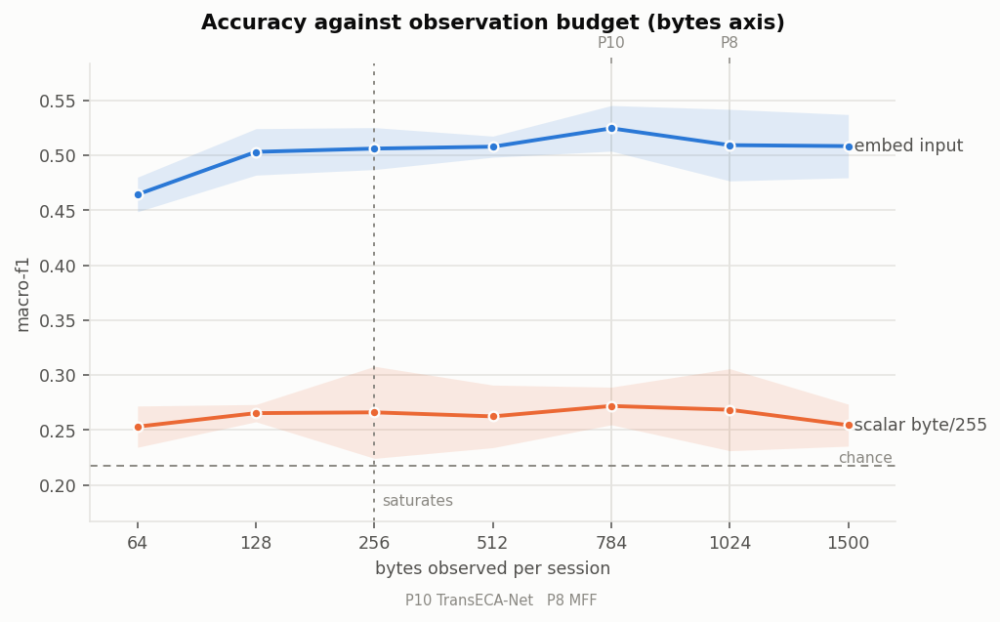

*Accuracy against byte budget, with the reviewed papers' choices marked.*

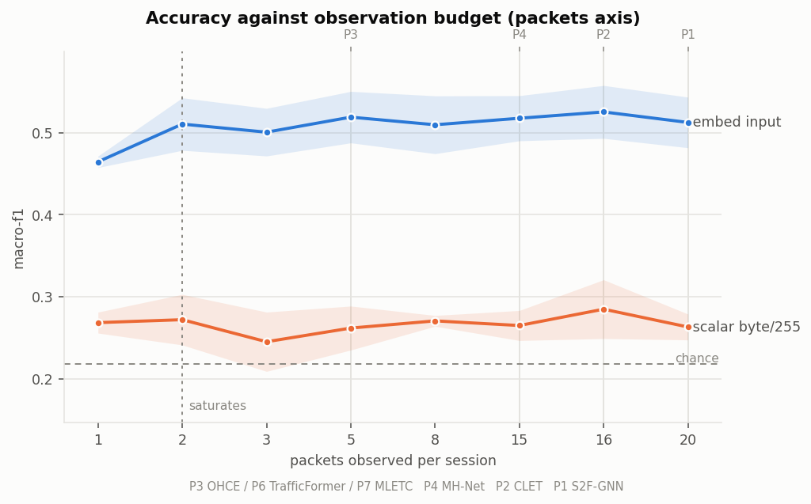

*Accuracy against packet budget.*

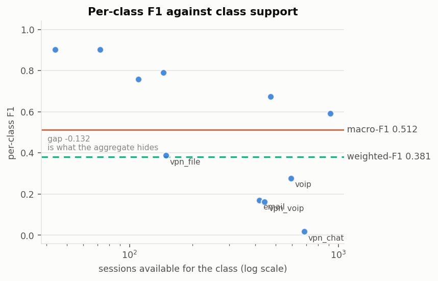

*Per-class F1 against class support, with the macro/weighted gap.*

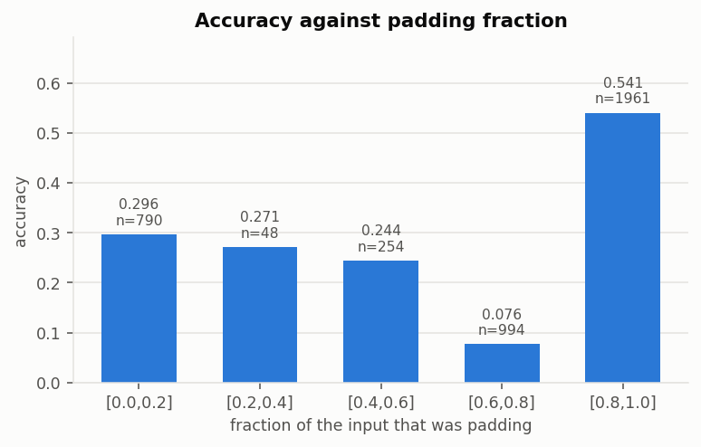

*Accuracy against padding fraction.*

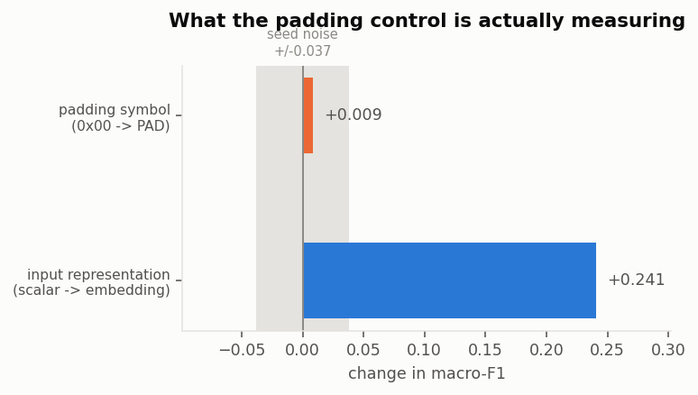

*What the padding control actually measures.*

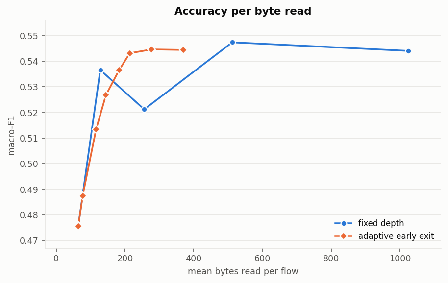

*Fixed depth against the adaptive exit policy.*

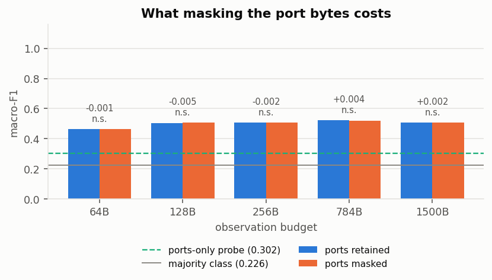

*What masking the port bytes costs, against the ports-only probe and the majority-class rate.*

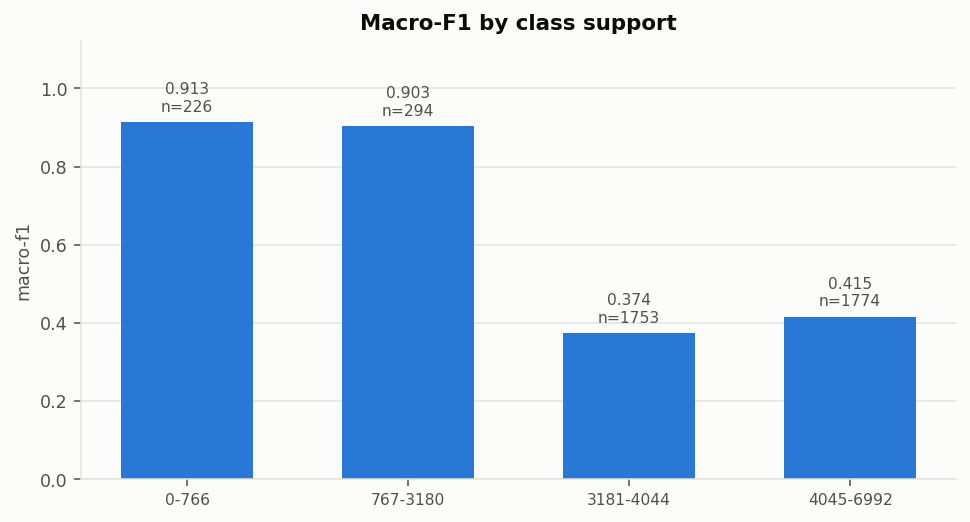

*Macro-F1 by class support.*

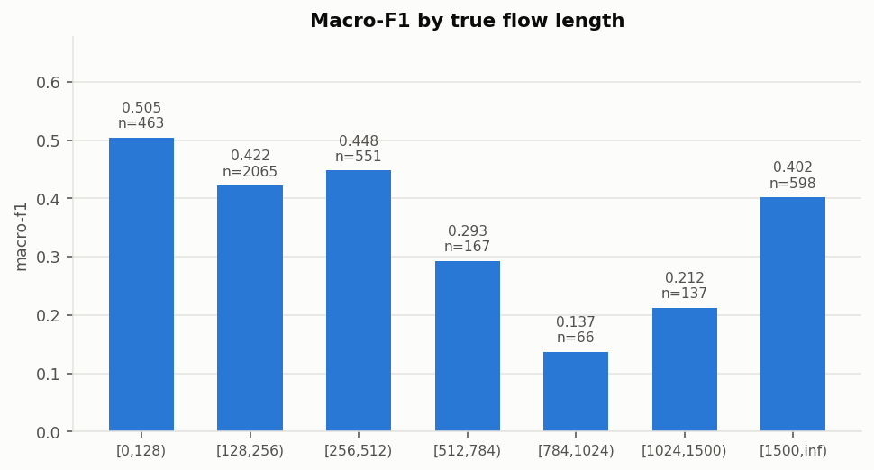

*Macro-F1 by true flow length.*

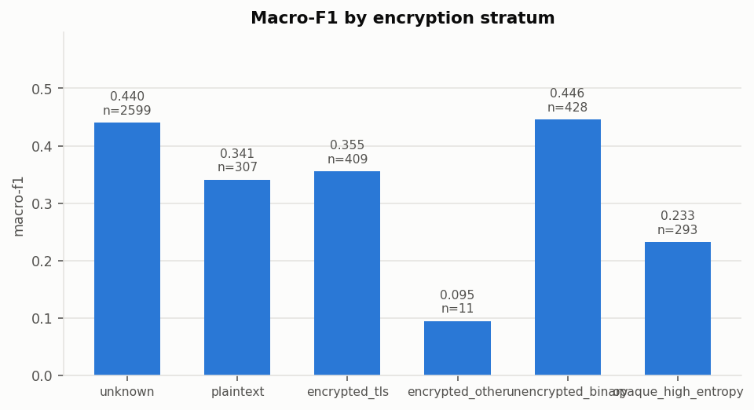

*Macro-F1 by encryption stratum.*


## 5. Comparison with existing research

```
Comparison on iscx

method                   year  budget                         acc  macroF1
--------------------------------------------------------------------------
P1 S2F-GNN               2026  20 packets, 10 x 0.1 s wi…  0.9326       --
      not comparable: does not state whether identifier fields were removed
      not comparable: reports accuracy but not macro-F1
      accuracy at 20% labels; the headline claim is few-shot, not full-label

P1 S2F-GNN               2026  20 packets, 5% labels           --   0.8754
      not comparable: does not state whether identifier fields were removed
      F1 at 5% labels

P2 CLET                  2026  16 packets, header descri…  0.8861   0.8280
      not comparable: different class scheme (14 against 11)
      not comparable: does not state whether identifier fields were removed
      not comparable: different session filtering
      DNS and SSDP removed, leaving 4,511 of 13,520 sessions; AIM 0% and SFTP 50% inside this macro-F1

P4 MH-Net                2025  15 packets, flow level      0.9942   0.9941
      not comparable: different class scheme (6 against 11)
      flow level; removing the 8-bit view collapses F1 to 0.1702

P4 MH-Net                2025  15 packets, packet level    0.9768   0.9766
      not comparable: different class scheme (6 against 11)
      packet level

P5 SoK (ET-BERT)         2025  varies by occlusion         0.9600       --
      not comparable: identifier fields retained, which P5 shows is worth up to 0.45 accuracy on its own
      not comparable: different session filtering
      not comparable: reports accuracy but not macro-F1
      0.96 with identifier fields present, 0.51 with them removed

P5 SoK (YaTC)            2025  varies by occlusion         0.9000       --
      not comparable: identifier fields retained, which P5 shows is worth up to 0.45 accuracy on its own
      not comparable: reports accuracy but not macro-F1
      0.90 with identifiers, 0.62 without; encrypted payload alone 0.30

P7 MLETC                 2025  5 packets x 100 bytes       0.9875   0.9880
      not comparable: different class scheme (6 against 11)
      budget chosen to fit a 512-token ceiling, by the authors' own account

P8 MFF                   2025  1024 bytes                  0.9961       --
      not comparable: different class scheme (12 against 11)
      not comparable: reports accuracy but not macro-F1
      about 87% of ISCX-VPN sessions fall below this budget and are padded

P9 Dual Embedding + GNN  2025  fixed packet count          0.9670   0.9600
      not comparable: identifier fields retained, which P5 shows is worth up to 0.45 accuracy on its own
      retains source and destination IP addresses and ports as inputs

P10 TransECA-Net         2025  784 bytes                   0.9765       --
      not comparable: different class scheme (12 against 11)
      not comparable: reports accuracy but not macro-F1
      per-class far weaker than the headline: File 93.56%, VoIP 92.20%

P11 CL-MetaFlow          2025  no payload used                 --   0.6200
      not comparable: different class scheme (17 against 11)
      5-way 5-shot; far lower than closed-world figures, by design

P12 Stacked ensembles    2025  88 flow-level features      0.9930       --
      not comparable: different class scheme (6 against 11)
      not comparable: does not state whether identifier fields were removed
      not comparable: reports accuracy but not macro-F1
      flow statistics, not raw bytes; fitting the scaler on all data inflates accuracy from 0.9949 to 0.9960

--------------------------------------------------------------------------
this work (wang1d)       2026  784B                        0.4419   0.5245
      identifiers removed, and the removal verified by a positive control

Read with care. These figures were produced under different preprocessing, different class schemes and different splits, and
several of the papers do not say whether identifier fields were removed. P5 measured that removing them costs ET-BERT 0.45
accuracy, so a retained-identifier number and an anonymised number are not measuring the same task. The budgets, by contrast,
are directly comparable, and locating them on our own sweep is the point of the exercise.
```


## 6. Ablation studies

### Step 10(i): representation, matched budget

```

variant                         macro-F1      sd    delta  verdict
1D sequence                       0.5245  0.0208  (reference)
2D byte image 28x28               0.5108  0.0099  -0.0137  inconclusive
1D Deep Packet                    0.5064  0.0050  -0.0181  inconclusive
```

### Step 10(ii): layer scope

```

variant                         macro-F1      sd    delta  verdict
all layers                        0.5245  0.0208  (reference)
headers only                      0.4857  0.0635  -0.0388  inconclusive
payload only                      0.4268  0.0039  -0.0978  worse
```

### Step 10(iv): early-exit supervision

```

variant                         macro-F1      sd    delta  verdict
all heads supervised              0.5440  0.0383  (reference)
terminal head only                0.5338  0.0162  -0.0103  inconclusive
```

### Step 10(iii): granularity

Bidirectional sessions against unidirectional flows at 784B. The unit of analysis is fixed when the store is written, so this is the one ablation that needs a second pass over the captures rather than another slice.

| unit | macro-F1 | accuracy | units | test | median true length |
|---|---|---|---|---|---|
| bidirectional session | 0.5234 ± 0.0275 | 0.4365 ± 0.0647 | 31,855 | 4,047 | 274 B |
| unidirectional flow | 0.4259 ± 0.0111 | 0.3183 ± 0.0113 | 50,488 | 7,668 | 159 B |

Difference -0.0976 macro-F1 against 0.0275 of seed noise. Verdict: **session better**.

*One session becomes up to two flows, so the two settings differ in sample count as well as in granularity; the comparison is between settings, not between equally-sized datasets.* Here that is 31,855 units against 50,488, and a median true length of 274 B against 159 B. The flow setting is therefore the less truncated one, and it still lost. That matters: truncation would have pushed the result the other way, so it cannot explain the session advantage. Pairing the two directions carries information that reading them separately does not, and the confound in this design works against that conclusion rather than for it.

### Port dependence (Step 11, the retained-field control)

Phase 2 Step 3c retained ports, citing P1's ablation, and deferred the consequence to Step 11. Two measurements answer it, and they point in different directions, so both are reported.

A probe trained on nothing but the four port bytes reaches **0.3019** accuracy against a 0.2258 majority-class rate: a strong shortcut is available. But masking those bytes in every packet costs almost nothing above the smallest budget.

| budget | with ports | ports masked | lost | conclusive |
|---|---|---|---|---|
| 64B | 0.4643 ± 0.0158 | 0.4655 ± 0.0194 | -0.0012 | no |
| 128B | 0.5031 ± 0.0212 | 0.5083 ± 0.0253 | -0.0052 | no |
| 256B | 0.5061 ± 0.0191 | 0.5084 ± 0.0128 | -0.0023 | no |
| 784B | 0.5245 ± 0.0208 | 0.5205 ± 0.0146 | +0.0040 | no |
| 1500B | 0.5083 ± 0.0288 | 0.5063 ± 0.0239 | +0.0020 | no |

So port information is *redundantly encoded* rather than load-bearing: at no budget in the sweep does masking the port bytes change macro-F1 by more than seed noise. The budget curve is not a port artifact on this corpus.

### Padding controls

| control | macro-F1 | change against zero padding |
|---|---|---|
| zero | 0.2684 ± 0.0373 |  |
| embed | 0.5092 ± 0.0326 | +0.2408 |
| mask | 0.5178 ± 0.0183 | +0.2494 |
| convmask | 0.3001 ± 0.0235 | +0.0317 |
| length_balanced | 0.1106 ± 0.0319 | -0.1578 |

Moving from the scalar input to an embedding with a PAD symbol changes two things at once. Split: **representation +0.2408**, **padding symbol +0.0086** (seed noise 0.0373; the padding effect is inside it).


## 7. Results analysis and discussion

Two stratified runs are reported. The sweep used a 5,000-per-class cap to control runtime and the corpus's 14x imbalance, but that cap applies to the test set too and flattens exactly the minority-class behaviour Gap 2 concerns. The uncapped run below restores the native class distribution; the capped figures are in `e3_stratified_wang1d_784B.json`.

### What the aggregate conceals

Overall at 784B: accuracy 0.4013, macro-F1 0.5110, weighted-F1 0.3798. The macro-to-weighted gap is **-0.1313**.

### By true flow length

| stratum | n | accuracy | macro-F1 |
|---|---|---|---|
| [0,128) | 463 | 0.6285 | 0.4491 |
| [128,256) | 2065 | 0.3191 | 0.3948 |
| [256,512) | 551 | 0.5354 | 0.5109 |
| [512,784) | 167 | 0.2515 | 0.2120 |
| [784,1024) | 66 | 0.4091 | 0.2188 |
| [1024,1500) | 137 | 0.1971 | 0.2189 |
| [1500,inf) | 598 | 0.4732 | 0.4235 |

### By class support

| stratum | n | accuracy | macro-F1 |
|---|---|---|---|
| 0-766 | 226 | 0.8407 | 0.9074 |
| 767-3180 | 294 | 0.8401 | 0.9033 |
| 3181-4044 | 1753 | 0.2886 | 0.4096 |
| 4045-6992 | 1774 | 0.3839 | 0.3737 |

### By encryption stratum

| stratum | n | accuracy | macro-F1 |
|---|---|---|---|
| unknown | 2599 | 0.3536 | 0.4258 |
| plaintext | 307 | 0.7068 | 0.3857 |
| encrypted_tls | 409 | 0.5208 | 0.3809 |
| encrypted_other | 11 | 0.1818 | 0.1667 |
| unencrypted_binary | 428 | 0.5187 | 0.4961 |
| opaque_high_entropy | 293 | 0.1741 | 0.2253 |

### The adaptive policy

the adaptive policy matches the best fixed head's macro-F1 (0.5474 at 512 bytes) while reading 116 bytes on average, 23% of the fixed cost

At tau=0.70 the policy reads 116 bytes on average against 512 for the best fixed head, 23% of the cost.

### Representation

Best macro-F1 with the embedding input 0.5245, with the scalar byte/255 input 0.2718, a difference of +0.2527. The budget curve therefore has no meaning independent of the representation it was measured with, which is a caution about comparing budget choices across papers that differ in this respect.

### Against the Phase 1 research gaps

Each gap below is answered on iscx alone. Where the two corpora disagree, the cross-corpus reading is in `../README.md`; a gap answered on one corpus is not answered in general.

#### Gap 1: the observation budget is inherited, not measured

The byte sweep saturates at **256B**: the best larger budget, 784B, adds only 0.0184 macro-F1, inside the 0.0326 seed noise.
The packet sweep saturates at **2P**: the best larger budget, 16P, adds only 0.0148 macro-F1, inside the 0.0353 seed noise.

Of the 6 budgets the reviewed papers use, **6 sit at or past the saturation point**:

| paper budget | paper | at or past saturation |
|---|---|---|
| 784B | P10 TransECA-Net | yes |
| 1024B | P8 MFF | yes |
| 5P | P3 OHCE / P6 TrafficFormer / P7 MLETC | yes |
| 15P | P4 MH-Net | yes |
| 16P | P2 CLET | yes |
| 20P | P1 S2F-GNN | yes |

None of those papers justifies its budget by a sweep; the value is carried over from earlier work. What that carried-over value actually costs is settled below by a paired test, which measures the same comparison per session rather than per run.

The paired test compares 256B against 784B on the same 428 sessions that the two models answered differently (p = 0.000129). It favours **784B**, the larger budget, by 254 sessions to 174, yet the gain of +0.0184 macro-F1 is smaller than the 0.0326 spread between seeds.

Both are correct, because they ask different questions. McNemar asks whether *this* model beats *that* one on these sessions, and with thousands of paired sessions it detects a small effect easily. The seed-noise verdict asks whether the advantage survives simply retraining with another seed. So the extra bytes buy a little, and less than the noise a practitioner already lives with, while the collection cost scales with every one of them.

#### Gap 2: minority and short classes failing inside aggregate metrics

The concealment gap is **-0.1313** (weighted-F1 0.3798 against macro-F1 0.5110). 
It is *negative*, which inverts the gap as Phase 1 framed it: here the frequent classes are the hard ones, so a weighted average reports **worse** than a macro average rather than flattering it. Either way the single headline number misleads, and only the sign of the error changes.

The worst class is `vpn_chat`: **F1 0.080, recall 0.042** on 686 test sessions, not a thin class scraping by, but one of the better-populated classes, which the model almost never predicts.
 Nothing falls under the 0.05 line used to flag an outright failure, but 0.080 F1 at 0.042 recall is a failure by any reading of it, and the aggregate does not show it. The threshold is a flag, not the finding.

By class support, the smallest-support classes score *higher*: 0-766 at macro-F1 0.9074 against 4045-6992 at 0.3737.

That is the opposite of the literature's framing, and it is why the split-strategy caveat below matters: class support and split strategy are confounded on this corpus, so this ordering is not safe to read as a statement about support.

*Measured on the uncapped split. The capped run flattens exactly the minority-class behaviour this gap is about, so it is reported beside it rather than instead of it.*

#### Gap 3: how much of the corpus is actually encrypted

This is reported as two bounds rather than one number, because the tagger resolves only part of the corpus. **27.6%** of sessions are definitely *not* encrypted: plaintext, or a recognisable unencrypted binary protocol. **7.4%** carry a TLS handshake that could be parsed and confirmed. The remainder is unresolved: a session with no readable handshake may be encrypted, tunnelled, or simply too short to tell.

So the encrypted share lies between **7.4%** and **72.4%**. The useful half of that is the lower bound: only 7.4% of this corpus is *confirmed* encrypted traffic, which is less than a paper describing it as an encrypted-traffic benchmark implies. The upper bound is what stops this being a stronger claim. P5's figure of around 95-99% unencrypted is neither reproduced nor contradicted here, because the method used cannot resolve the 62.5% it leaves unknown.

Of the 1742 handshakes that were parsed, **13.5% negotiate a suite that is now deprecated**. That is low enough that the confirmed-encrypted portion of this corpus is not obviously obsolete on cipher grounds, unlike the other corpus in this study, where the same measurement comes out the opposite way. The age of a benchmark's ciphers has to be measured per corpus; it cannot be assumed either way.


| budget | sessions padded rather than truncated |
|---|---|
| 64B | 0.4% |
| 128B | 5.1% |
| 256B | 48.1% |
| 512B | 84.8% |
| 784B | 87.0% |
| 1024B | 87.9% |
| 1500B | 89.4% |

The padding column is the other half of the gap. At the two byte budgets the reviewed papers use, 87.0%-87.9% of sessions are shorter than the budget, so for those sessions part of what the model reads is padding rather than traffic. No reviewed paper reports this fraction.

#### Gap 4: shortcut learning and the positive control

The gate holds. A probe reading only the anonymised MAC and IP byte positions reaches 0.1095 accuracy against a 0.2258 majority-class rate, below chance, so anonymisation left no usable identifier signal. Gate verdict: **passed**.

The same positions *before* anonymisation reach 0.5330, which is how much identifier shortcut the anonymisation destroyed. A pipeline that skipped that step would have had that much free accuracy available, and no reviewed paper runs this control.

Ports are the retained-field risk: a ports-only probe reaches 0.3019.
 Masking those bytes costs the full model at most **+0.0040** macro-F1, at 784B, and that one is inside seed noise.
 At every other budget the cost is no more than +0.0020.
 So on the averaged measurement the information looks redundantly encoded rather than load-bearing: the shortcut is available, and the model does not obviously depend on it once it can see past the header.


A paired test at 256B on the same 451 sessions the two settings disagreed about gives p = 0.451, detecting no reliable difference. The shortcut is available and the model does not use it, and the two measurements agree.

On padding specifically, the apparent benefit of a PAD symbol decomposes into **+0.2408** from the representation and **+0.0086** from the padding symbol itself, against 0.0373 of seed noise.
 Only the representation clears that bar. The gain usually credited to padding-aware input is the embedding, and reporting the combined figure as a padding result would misattribute nearly all of it.

The length-balanced control equalises the flow-length distribution across the 6 of 11 classes that occupy every length bin, leaving **84 test sessions** and a 0.1667 within-set chance rate. It asks whether anything survives when flow length can no longer separate the classes.
 It scores macro-F1 **0.1106** (std 0.0319, 0.2262 accuracy).

That is at or below the 0.1667 chance rate, and the three seeds agree. On this corpus **little survives once flow length is equalised**, which puts a large share of the apparent signal on length rather than on content, the confound this study was built to look for.

Two things bound how far that goes. The test set is 84 sessions, so the effect size is imprecise even where the direction is unambiguous. And the retained classes are a biased subset by construction: the ones whose lengths overlap every other class, which is to say the ones least likely to have been separable by length in the first place.

*Retained: `chat`, `email`, `file`, `voip`, `vpn_file`, `vpn_voip`. Excluded for not spanning all bins: `streaming`, `vpn_chat`, `vpn_email`, `vpn_p2p`, `vpn_streaming`.*

#### The limitation that cuts across all four

**5 of 11 classes on this corpus are split temporally, not group-wise.** A temporal split draws train and test from the same capture and separates them only in time. It is a fallback, for two distinct reasons:

- the class occupies fewer than three capture files, so whole files cannot be held out at all; or
- a group split was attempted and left one of the three splits empty, because the class's files are too unevenly sized to divide 70/15/15.

*group split left a split empty*: `chat`, `voip`, `vpn_file`.

*single capture file*: `vpn_email`, `vpn_p2p`.

This is a property of the corpus, not a choice: the captures do not exist to split any other way. But it means per-class scores are not on one scale, and every number above that compares classes is confounded with it. It also sets a ceiling on how much of the headline accuracy should be believed to transfer to unseen captures, the usual deployment case, and the one a random within-capture split measures least well.

Relatedly, only **101 of 140 capture files contributed a unique session**. Sessionizing by five-tuple merges a conversation the corpus ships split across two files, and content dedup drops a session a second capture repeats, so 39 files add nothing. That shrinks the pool of groups a group-wise split can draw on, which is part of why the fallback above fires as often as it does.

<details><summary>The 39 captures that contributed no unique session</summary>

`AIMchat1`, `AIMchat2`, `ICQchat1`, `ICQchat2`, `facebook_audio1b`, `facebook_audio2b`, `facebook_audio3`, `facebook_audio4`, `facebook_video1b`, `facebook_video2b`, `facebookchat1`, `facebookchat2`, `facebookchat3`, `gmailchat1`, `gmailchat2`, `gmailchat3`, `hangouts_audio1b`, `hangouts_audio2b`, `hangouts_audio3`, `hangouts_audio4`, `hangouts_video1b`, `hangouts_video2b`, `scp1`, `sftp1`, `skype_audio1b`, `skype_audio2b`, `skype_audio3`, `skype_audio4`, `skype_file4`, `skype_file5`, `skype_file6`, `skype_file7`, `skype_file8`, `skype_video1b`, `skype_video2b`, `voipbuster1b`, `voipbuster2b`, `voipbuster3b`, `vpn_hangouts_audio2`

</details>

#### What that limitation is actually worth

**6 of this corpus's 11 classes have enough capture files to be split either way**, which makes the question answerable rather than merely admissible. The three arms below hold the classes, the budget (256B), the model, the epochs and *the per-class train/val/test sizes* fixed, and vary only where the boundary falls. Matching the sizes is what makes this a measurement: the group arm's splits land where the capture files happen to fall, so the other two are cut to those same sizes rather than to a tidy 70/15/15.

8 seeds, 14697 training and 2275 test sessions in every arm. Classes: `email`, `file`, `streaming`, `vpn_chat`, `vpn_streaming`, `vpn_voip` (chance 0.1667).

| train/test boundary | accuracy | macro-F1 | vs group-wise | verdict |
|---|---|---|---|---|
| group-wise, unseen capture | 0.5388 ± 0.0431 | 0.5596 ± 0.0510 | (reference) |  |
| temporal, same captures, later in time | 0.6439 ± 0.0337 | 0.6027 ± 0.0337 | +0.0431 | inconclusive |
| random, same captures, no time boundary | 0.9463 ± 0.0038 | 0.9378 ± 0.0046 | +0.3782 | inflated |

**A random within-capture split is worth +0.3782 macro-F1**: 0.9378 against 0.5596, on the same classes, at the same budget, with the same split sizes. That is 7 times the seed noise, and it buys nothing but permission for the test set to share captures with training. An accuracy of 0.95 on this corpus is reachable without the model generalising past the capture file at all. A paper that does not state its split policy has most likely taken this arm.

**The temporal fallback used here is not measurably worse than a group-wise split**: +0.0431 against 0.0510 of seed noise. So the fallback sits far closer to the honest arm than to the random one, and the numbers in this report are not inflated the way a random split's would be. That is a weaker claim than *the fallback is free*. The difference may be real and too small to resolve at 8 seeds, but it bounds the concern.

Three caveats keep this from being more than it is. The arms score different test sessions, so no paired test applies and the verdict is the seed-noise rule of Step 9. The group arm is the noisiest of the three because whole capture files move between splits, which sets the bar any difference has to clear. And these 6 classes are not a random sample of the corpus. They are the ones with enough captures to split both ways, which is itself a property that may correlate with difficulty.

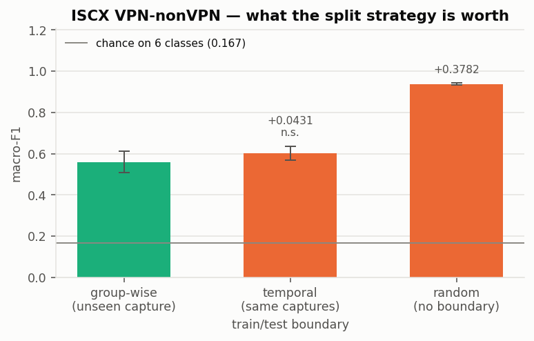

*Macro-F1 against where the train/test boundary falls. Error bars are the seed standard deviation.*

#### 2 further limitations

- **The class list is short by 1.** The category, vpn-aware scheme defines 12 classes, but the label set is derived from the captures that are present. Absent here: `p2p`. Every number in this report is therefore on 11 classes, not 12, and chance rates are set accordingly. That is a property of the release rather than of this download: all 140 capture files the 5 distributed archives declare are present and extracted, and the only `p2p` capture in any of them is the VPN one (`vpn_bittorrent.pcap`), which this corpus already carries as a separate class. A paper reporting the full taxonomy on this corpus is therefore working from a different release or a different labelling, which is a comparability obstacle in its own right and is recorded as one in §5.

- **Runs are capped at 5,000 sessions per class**, which binds on 2 of 11 classes (`vpn_voip` 6992, `chat` 6093). The cap applies to the test set as well as the training set, so it flattens the imbalance Gap 2 is about: from 23.9x between the largest and smallest class down to 17.1x. Where an uncapped run exists it is used for the stratified analysis; where it does not, the Gap 2 numbers above understate how uneven the corpus really is.


---

Reproduce with the commands in `README.md`. Every figure and table above is generated from the JSON in this directory by `scripts/make_report.py`.