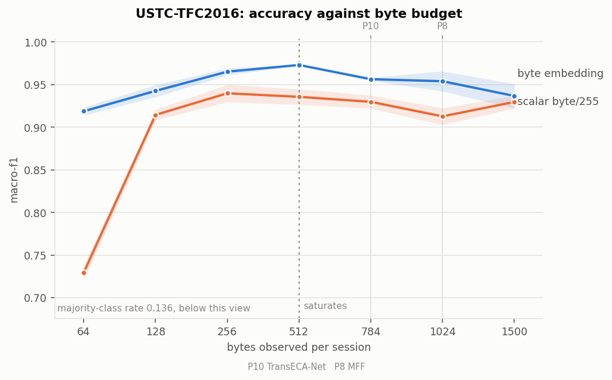
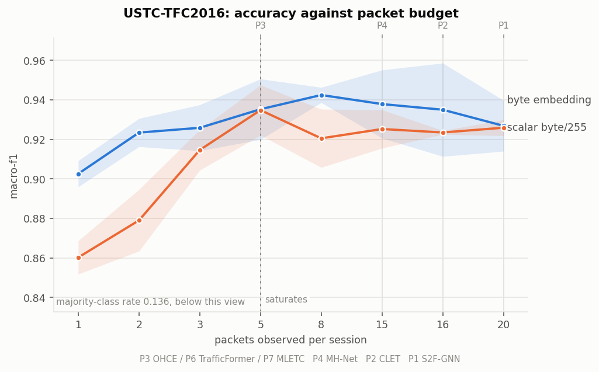
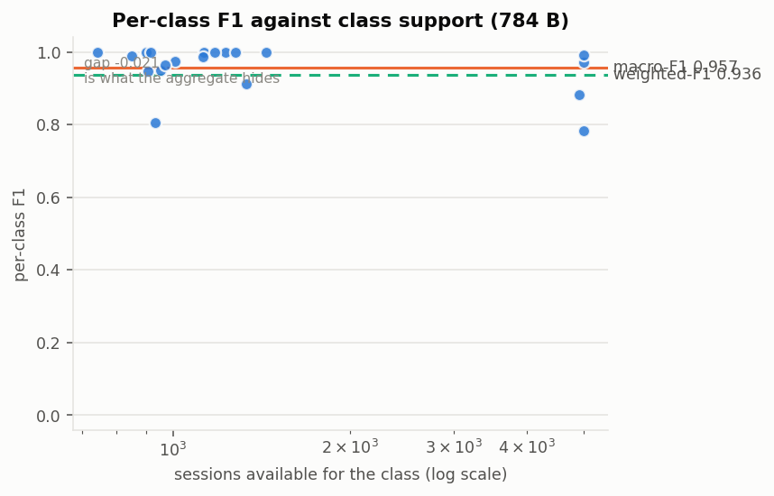
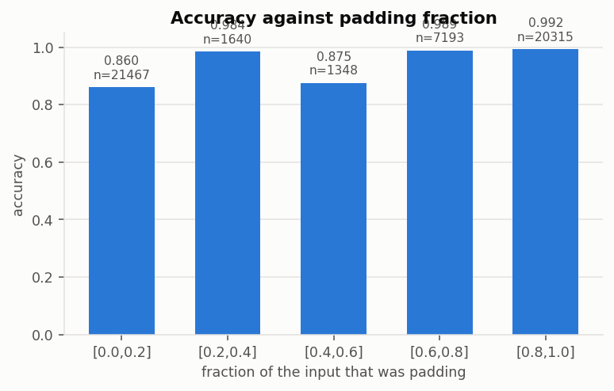
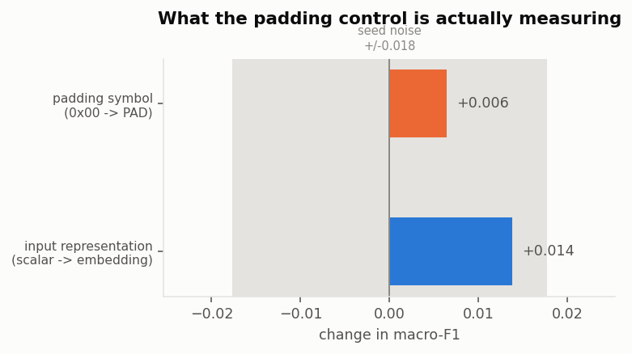
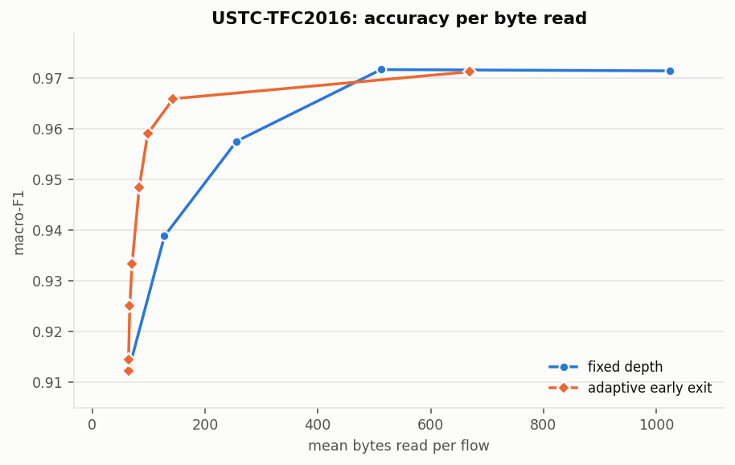
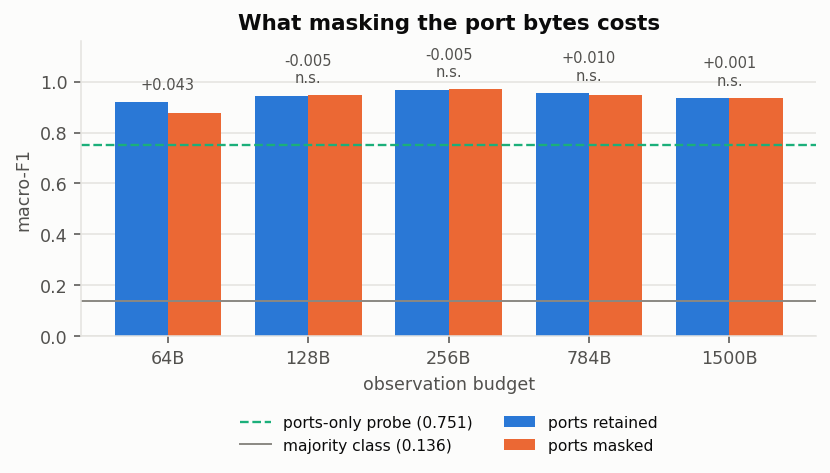
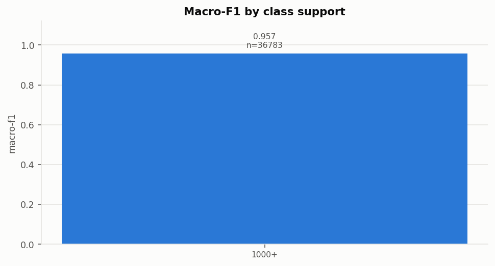
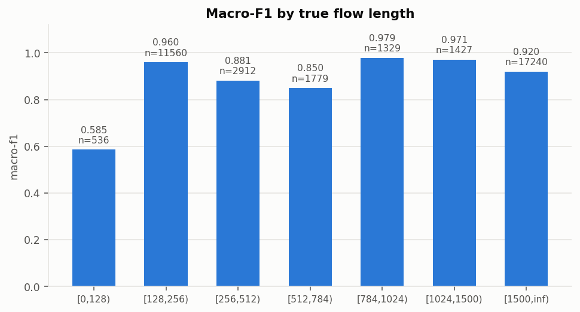
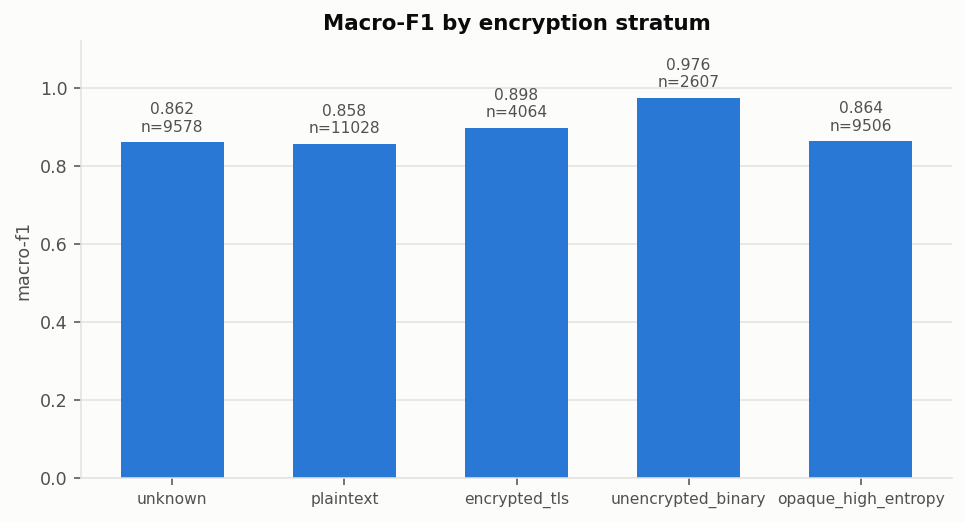

# Phase 3: Implementation and Experimental Evaluation

**Observation Budgets and Padding Effects in Raw-Byte Network Traffic Classification**

Muhammad Talha Arshad (i232548) · Zain Shahid (i232582)

Run: model `wang1d`, input representation `embed`, seeds [0, 1, 2], 36 minutes on one RTX 5050.


## 1-2. Implementation, dataset and experimental setup

### Changes from the Phase 2 methodology

7 changes, each forced by something found while implementing or running. Lifted from `PHASE3.md`, which remains the requirement map.

1. **An input-representation axis was added.** Phase 2 Step 4 specified raw
   bytes normalised to [0, 1]. Implementation showed that this representation
   cannot match exact byte values (after scaling, two byte values one apart
   differ by 0.004) and on a corpus with a cue planted past byte 780 it
   plateaus at 0.492 macro-F1 while a learned byte embedding reaches 1.000.
   Since the budget curve is the study's primary instrument, and its shape
   depends on this choice, the representation is now swept as a variable
   rather than fixed. `--compare-representations` runs both.

2. **The padding control gained an attribution arm.** Step 11(ii) proposed
   comparing zero padding against a masked embedding. Those differ in two
   ways at once, and on synthetic data the combined effect is +0.519 macro-F1
   of which the padding symbol contributes +0.000. A fourth mode (`embed`:
   embedding input, ordinary zero padding) was added so the two are separable.

3. **The leakage control was split into three probes.** Step 11(i) described
   training on "the fields that were supposed to be anonymised", which is
   ambiguous. It is now: `id_positions` (those byte positions read from the
   *anonymised* store, the halt condition, which must sit at chance), `ident`
   (the same positions *before* anonymisation, context, expected to be high),
   and `ports` (the fields Step 3c deliberately retains, a reported risk, not a
   gate).

4. **The adaptive classifier's encoder is causal.** Step 5 specified early-exit
   heads at byte depths but not how to guarantee a head's output depends only
   on bytes before its depth. Without that guarantee the accuracy-per-byte
   frontier is meaningless. The encoder uses dilated causal convolutions and
   per-position normalisation; `tests/test_models_causality.py` asserts that
   head *k* returns bit-identical logits from a truncated and a full input.

5. **The split is group-wise *where the corpus allows it*, and temporal where
   it does not.** Step 3f specified a group-wise split with whole capture
   files held out. On real data that is often impossible: a class whose
   sessions come from fewer than three capture files has no files to hold out,
   and a class whose files are very unevenly sized can leave one of the three
   splits empty. `make_split` therefore falls back per class to a temporal
   split on first-packet timestamp, and records which strategy each class got
   so the reports can carry the caveat. This matters more than it sounds: 19
   of 20 USTC classes and 5 of 11 ISCX classes end up temporal, meaning train
   and test come from the same capture, the easier problem. It is a property
   of these corpora rather than a choice, but it bounds what the headline
   numbers mean, and the two corpora cannot be compared without it.

6. **The split strategy became an experiment rather than a caveat.** Change 5
   left the study's largest limitation unquantified: the corpus that scores
   higher is also the one split the easier way, and nothing in the Phase 2
   plan could separate those. Six ISCX classes have enough capture files to be
   split either way, which makes the question answerable within one corpus.
   `run_split_strategy.py` holds the classes, budget, model, epochs, seeds
   *and per-class split sizes* fixed and varies only where the train/test
   boundary falls: whole capture files, a timestamp inside those captures, or
   nothing. Matching the sizes is what turns it from a third confound into a
   measurement. The result is that a random within-capture split is worth
   +0.3782 macro-F1 over a group-wise one, while the temporal fallback this
   study actually uses is not measurably worse than group-wise (+0.0431
   against 0.0510 of seed noise). This was not in the Phase 2 plan; it exists
   because the limitation was worth measuring rather than conceding.

7. **The model family became a controlled variable.** Phase 2 fixed the
   classifier to the byte-image and byte-sequence CNNs the baselines come
   from. Every one of the twelve reviewed papers uses a transformer or a graph
   network instead, so a saturation point measured only under convolution
   could not be claimed to say anything about the architectures the field
   actually uses. A byte-level transformer (`models.ByteTransformer`: patch
   tokenisation by strided convolution, four pre-norm encoder layers, a
   key-padding mask) now carries the whole E2 sweep on ISCX with the store,
   split manifest, schedule and seeds held fixed. The two families are not
   separable: peaks of 0.5245 ± 0.0208 and 0.5195 ± 0.0379, saturating at the
   same packet budget. So the budget finding is a property of the data rather
   than of the convolutional stack. The transformer is trained from scratch
   and is not comparable to the pre-trained models it is modelled on; that is
   recorded as a limitation rather than worked around.


### The leakage gate

Before any result is reported, the same architecture is trained on restricted views of the input. The gate is the first row: those byte positions are read out of the *anonymised* store, so a score above the majority-class rate would mean the anonymisation did not land.

| probe | input | accuracy | majority-class rate |
|---|---|---|---|
| **gate** | MAC/IP positions, after anonymisation | 0.1351 ± 0.0014 | 0.1359 |
| context | the same positions, before anonymisation | 0.3851 ± 0.0098 | 0.1359 |
| risk | the retained port bytes | 0.7509 ± 0.0053 | 0.1359 |

**Gate passed** (excess over chance -0.0008, margin 0.1).

The port probe scores above chance. Ports are retained deliberately (Phase 2 Step 3c, following P1's ablation), so this is not a gate failure, but it means some of the headline accuracy is port information rather than traffic content and must be read that way.


## 3. Baseline evaluation

| baseline | budget | accuracy | macro-F1 | weighted-F1 |
|---|---|---|---|---|
| Wang et al. 2017 byte image (28×28) | 784B | 0.9566 ± 0.0245 | 0.9595 ± 0.0095 | 0.9540 ± 0.0272 |
| Wang et al. 2017 1D-CNN | 784B | 0.9407 ± 0.0154 | 0.9564 ± 0.0018 | 0.9375 ± 0.0170 |
| Deep Packet (Lotfollahi et al. 2020) | 1500B | 0.9460 ± 0.0206 | 0.9574 ± 0.0045 | 0.9432 ± 0.0228 |

### Paired significance tests

A seed-noise verdict asks whether a difference exceeds run-to-run variation. For comparisons scored on the *same* test sessions, McNemar's exact test asks a sharper question: whether one setting reliably beats the other on these sessions. Both are reported, because they can disagree and the disagreement is informative.

| pair | A | B | discordant B→A / A→B | p | significant |
|---|---|---|---|---|---|
| saturation | 512B 0.9895 | 784B 0.9434 | 94 / 2488 | 0 | **yes** |
| ports | ports retained 0.9895 | ports masked 0.9477 | 107 / 2277 | 0 | **yes** |

*Seed 0, 51,963 paired test sessions. The granularity ablation is deliberately absent: sessions and flows are different units, so the test sets differ in size and McNemar does not apply.*


## 4. Graphical results

The study's primary result. Architecture, optimiser, schedule, split and seeds are held constant; only the number of bytes the model may read changes.

| byte budget | macro-F1 | accuracy | mean padding fraction |
|---|---|---|---|
| 64B | 0.9188 ± 0.0047 | 0.9560 ± 0.0067 | 0.000 |
| 128B | 0.9426 ± 0.0070 | 0.9672 ± 0.0019 | 0.006 |
| 256B | 0.9652 ± 0.0041 | 0.9772 ± 0.0018 | 0.105 |
| 512B | 0.9731 ± 0.0006 | 0.9726 ± 0.0112 | 0.242 |
| 784B | 0.9564 ± 0.0018 | 0.9407 ± 0.0154 | 0.307 |
| 1024B | 0.9540 ± 0.0118 | 0.9382 ± 0.0278 | 0.347 |
| 1500B | 0.9367 ± 0.0142 | 0.9205 ± 0.0088 | 0.398 |

**Saturation:** 512B: no larger budget improves on it by more than seed noise (0.0142).

| packet budget | macro-F1 | accuracy | tensor width |
|---|---|---|---|
| 1P | 0.9026 ± 0.0066 | 0.9172 ± 0.0229 | 1536 |
| 2P | 0.9235 ± 0.0071 | 0.9194 ± 0.0163 | 2048 |
| 3P | 0.9259 ± 0.0116 | 0.9204 ± 0.0190 | 2048 |
| 5P | 0.9353 ± 0.0153 | 0.9148 ± 0.0091 | 2048 |
| 8P | 0.9425 ± 0.0039 | 0.9181 ± 0.0020 | 2048 |
| 15P | 0.9379 ± 0.0172 | 0.9176 ± 0.0071 | 2048 |
| 16P | 0.9350 ± 0.0236 | 0.9160 ± 0.0116 | 2048 |
| 20P | 0.9269 ± 0.0129 | 0.9132 ± 0.0052 | 2048 |

**Saturation (packets):** 5P.



*Accuracy against byte budget, with the reviewed papers' choices marked.*



*Accuracy against packet budget.*



*Per-class F1 against class support, with the macro/weighted gap.*



*Accuracy against padding fraction.*



*What the padding control actually measures.*



*Fixed depth against the adaptive exit policy.*



*What masking the port bytes costs, against the ports-only probe and the majority-class rate.*



*Macro-F1 by class support.*



*Macro-F1 by true flow length.*



*Macro-F1 by encryption stratum.*


## 5. Comparison with existing research

```
Comparison on USTC-TFC2016

method                   year  budget                         acc  macroF1
--------------------------------------------------------------------------
P3 OHCE                  2026  5 packets                   0.9438       --
      not comparable: different session filtering
      not comparable: reports accuracy but not macro-F1
      open-set setting; flows under 5 packets discarded entirely

P7 MLETC                 2025  5 packets x 100 bytes       0.9902   0.9926
      broadly comparable: budget, class scheme and anonymisation align; preprocessing and splits still differ

P8 MFF                   2025  1024 bytes                  0.9999       --
      not comparable: reports accuracy but not macro-F1
      about 70% of USTC-TFC sessions are padded at this budget

P10 TransECA-Net         2025  784 bytes                   0.9825       --
      not comparable: different class scheme (10 against 20)
      not comparable: reports accuracy but not macro-F1
      ten benign classes only, used for generalisation

--------------------------------------------------------------------------
this work (wang1d)       2026  512B                        0.9726   0.9731
      identifiers removed, and the removal verified by a positive control

Read with care. These figures were produced under different preprocessing, different class schemes and different splits, and
several of the papers do not say whether identifier fields were removed. P5 measured that removing them costs ET-BERT 0.45
accuracy, so a retained-identifier number and an anonymised number are not measuring the same task. The budgets, by contrast,
are directly comparable, and locating them on our own sweep is the point of the exercise.
```


## 6. Ablation studies

### Step 10(i): representation, matched budget

```

variant                         macro-F1      sd    delta  verdict
1D sequence                       0.9564  0.0018  (reference)
2D byte image 28x28               0.9595  0.0095  +0.0031  inconclusive
1D Deep Packet                    0.9615  0.0209  +0.0051  inconclusive
```

### Step 10(ii): layer scope

```

variant                         macro-F1      sd    delta  verdict
all layers                        0.9564  0.0018  (reference)
headers only                      0.9531  0.0083  -0.0033  inconclusive
payload only                      0.9018  0.0012  -0.0546  worse
```

### Step 10(iv): early-exit supervision

```

variant                         macro-F1      sd    delta  verdict
all heads supervised              0.9714  0.0129  (reference)
terminal head only                0.9794  0.0074  +0.0080  inconclusive
```

### Step 10(iii): granularity

Bidirectional sessions against unidirectional flows at 784B. The unit of analysis is fixed when the store is written, so this is the one ablation that needs a second pass over the captures rather than another slice.

| unit | macro-F1 | accuracy | units | test | median true length |
|---|---|---|---|---|---|
| bidirectional session | 0.9500 ± 0.0304 | 0.9649 ± 0.0246 | 353,496 | 51,963 | 474 B |
| unidirectional flow | 0.9545 ± 0.0131 | 0.9645 ± 0.0183 | 454,230 | 67,071 | 288 B |

Difference +0.0045 macro-F1 against 0.0304 of seed noise. Verdict: **inconclusive**.

*One session becomes up to two flows, so the two settings differ in sample count as well as in granularity; the comparison is between settings, not between equally-sized datasets.* Here that is 353,496 units against 454,230, and a median true length of 474 B against 288 B. The flow setting is therefore the less truncated one, so granularity and effective budget move together. With the difference inside seed noise there is nothing to attribute, and this design could not have separated them had there been.

### Port dependence (Step 11, the retained-field control)

Phase 2 Step 3c retained ports, citing P1's ablation, and deferred the consequence to Step 11. Two measurements answer it, and they point in different directions, so both are reported.

A probe trained on nothing but the four port bytes reaches **0.7509** accuracy against a 0.1359 majority-class rate: a strong shortcut is available. But masking those bytes in every packet costs almost nothing above the smallest budget.

| budget | with ports | ports masked | lost | conclusive |
|---|---|---|---|---|
| 64B | 0.9188 ± 0.0047 | 0.8760 ± 0.0088 | +0.0428 | yes |
| 128B | 0.9426 ± 0.0070 | 0.9476 ± 0.0027 | -0.0050 | no |
| 256B | 0.9652 ± 0.0041 | 0.9699 ± 0.0063 | -0.0047 | no |
| 512B | 0.9832 ± 0.0016 | 0.9652 ± 0.0256 | +0.0181 | no |
| 784B | 0.9564 ± 0.0018 | 0.9463 ± 0.0173 | +0.0101 | no |
| 1500B | 0.9367 ± 0.0142 | 0.9358 ± 0.0048 | +0.0009 | no |

So port information is *redundantly encoded* rather than load-bearing: available as a shortcut, but masking it changes the result by more than seed noise only at 64B. Above 64B the difference is inside noise, so the budget curve there is not a port artifact.

### Padding controls

| control | macro-F1 | change against zero padding |
|---|---|---|
| zero | 0.9351 ± 0.0067 |  |
| embed | 0.9489 ± 0.0069 | +0.0138 |
| mask | 0.9553 ± 0.0176 | +0.0202 |
| convmask | 0.9399 ± 0.0053 | +0.0048 |
| length_balanced | 0.7907 ± 0.0133 | -0.1444 |

Moving from the scalar input to an embedding with a PAD symbol changes two things at once. Split: **representation +0.0138**, **padding symbol +0.0065** (seed noise 0.0176; the padding effect is inside it).


## 7. Results analysis and discussion

Two stratified runs are reported. The sweep used a 5,000-per-class cap to control runtime and the corpus's 14x imbalance, but that cap applies to the test set too and flattens exactly the minority-class behaviour Gap 2 concerns. The uncapped run below restores the native class distribution; the capped figures are in `e3_stratified_wang1d_784B.json`.

### What the aggregate conceals

Overall at 784B: accuracy 0.9409, macro-F1 0.9245, weighted-F1 0.9378. The macro-to-weighted gap is **+0.0133**.

### By true flow length

| stratum | n | accuracy | macro-F1 |
|---|---|---|---|
| [0,128) | 557 | 0.9677 | 0.7072 |
| [128,256) | 23240 | 0.9947 | 0.9280 |
| [256,512) | 4246 | 0.9270 | 0.9232 |
| [512,784) | 2434 | 0.8398 | 0.8548 |
| [784,1024) | 1650 | 0.9897 | 0.9779 |
| [1024,1500) | 1472 | 0.9891 | 0.9618 |
| [1500,inf) | 18364 | 0.8803 | 0.9113 |

### By class support

| stratum | n | accuracy | macro-F1 |
|---|---|---|---|
*bins derived from the corpus: USTC-TFC2016's smallest class holds ~5,000 sessions, so the sub-50-session regime the review identified in P2 does not exist here and cannot be tested on this corpus*

| 0-6172 | 4315 | 0.9103 | 0.9465 |
| 6173-7487 | 4980 | 0.9054 | 0.9287 |
| 7488-9048 | 6138 | 0.9871 | 0.9935 |
| 9049-83696 | 36530 | 0.9416 | 0.9274 |

### By encryption stratum

| stratum | n | accuracy | macro-F1 |
|---|---|---|---|
| unknown | 15259 | 0.9778 | 0.8581 |
| plaintext | 18737 | 0.9756 | 0.8869 |
| encrypted_tls | 4064 | 0.9050 | 0.8177 |
| unencrypted_binary | 3271 | 0.9936 | 0.8229 |
| opaque_high_entropy | 10632 | 0.8243 | 0.9002 |

### The adaptive policy

the adaptive policy matches the best fixed head's macro-F1 (0.9716 at 512 bytes) while reading 144 bytes on average, 28% of the fixed cost

At tau=0.99 the policy reads 144 bytes on average against 512 for the best fixed head, 28% of the cost.

### Representation

Best macro-F1 with the embedding input 0.9731, with the scalar byte/255 input 0.9398, a difference of +0.0332. The budget curve therefore has no meaning independent of the representation it was measured with, which is a caution about comparing budget choices across papers that differ in this respect.

### Against the Phase 1 research gaps

Each gap below is answered on USTC-TFC2016 alone. Where the two corpora disagree, the cross-corpus reading is in `../README.md`; a gap answered on one corpus is not answered in general.

#### Gap 1: the observation budget is inherited, not measured

The byte sweep saturates at **512B**: no larger budget beats it at all: the best of them, 784B, is 0.0167 macro-F1 *worse*.
The packet sweep saturates at **5P**: the best larger budget, 8P, adds only 0.0072 macro-F1, inside the 0.0236 seed noise.

Of the 6 budgets the reviewed papers use, **6 sit at or past the saturation point**:

| paper budget | paper | at or past saturation |
|---|---|---|
| 784B | P10 TransECA-Net | yes |
| 1024B | P8 MFF | yes |
| 5P | P3 OHCE / P6 TrafficFormer / P7 MLETC | yes |
| 15P | P4 MH-Net | yes |
| 16P | P2 CLET | yes |
| 20P | P1 S2F-GNN | yes |

None of those papers justifies its budget by a sweep; the value is carried over from earlier work. What that carried-over value actually costs is settled below by a paired test, which measures the same comparison per session rather than per run.

The paired test compares 512B against 784B on the same 2,582 sessions that the two models answered differently (p = 0). It favours **512B**, the smaller budget, by 2,488 sessions to 94. Reading on to 784B does not merely stop helping, it **actively hurts**, and reliably so.

That is a stronger statement than the seed-noise verdict can make. A budget past saturation is not a harmless over-collection: the extra bytes are mostly padding at these lengths, and training on them costs accuracy as well as collection cost.

#### Gap 2: minority and short classes failing inside aggregate metrics

The concealment gap is **+0.0133** (weighted-F1 0.9378 against macro-F1 0.9245). 
A weighted average therefore reports 0.0133 more F1 than the per-class picture supports.

The worst class is `Skype`: **F1 0.734, recall 0.580** on 914 test sessions.
 No class comes close to the 0.05 line used to flag an outright failure, so the specific failure mode P2 and P10 exhibit does not reproduce on this corpus.

By class support, the smallest-support classes score *higher*: 0-6172 at macro-F1 0.9465 against 9049-83696 at 0.9274.

That is the opposite of the literature's framing, and it is why the split-strategy caveat below matters: class support and split strategy are confounded on this corpus, so this ordering is not safe to read as a statement about support.

*Measured on the uncapped split. The capped run flattens exactly the minority-class behaviour this gap is about, so it is reported beside it rather than instead of it.*

#### Gap 3: how much of the corpus is actually encrypted

This is reported as two bounds rather than one number, because the tagger resolves only part of the corpus. **41.3%** of sessions are definitely *not* encrypted: plaintext, or a recognisable unencrypted binary protocol. **7.8%** carry a TLS handshake that could be parsed and confirmed. The remainder is unresolved: a session with no readable handshake may be encrypted, tunnelled, or simply too short to tell.

So the encrypted share lies between **7.8%** and **58.7%**. The useful half of that is the lower bound: only 7.8% of this corpus is *confirmed* encrypted traffic, which is less than a paper describing it as an encrypted-traffic benchmark implies. The upper bound is what stops this being a stronger claim. P5's figure of around 95-99% unencrypted is neither reproduced nor contradicted here, because the method used cannot resolve the 28.7% it leaves unknown.

Of the 6710 handshakes that were parsed, **95.2% negotiate a suite that is now deprecated**. So even the confirmed-encrypted portion does not resemble traffic a classifier would meet today: its ciphers predate the deployment it would be used in, and a model tuned on them is tuned on a handshake distribution that no longer exists.


| budget | sessions padded rather than truncated |
|---|---|
| 64B | 0.0% |
| 128B | 0.8% |
| 256B | 39.9% |
| 512B | 51.2% |
| 784B | 57.6% |
| 1024B | 60.3% |
| 1500B | 64.4% |

The padding column is the other half of the gap. At the two byte budgets the reviewed papers use, 57.6%-60.3% of sessions are shorter than the budget, so for those sessions part of what the model reads is padding rather than traffic. No reviewed paper reports this fraction.

#### Gap 4: shortcut learning and the positive control

The gate holds. A probe reading only the anonymised MAC and IP byte positions reaches 0.1351 accuracy against a 0.1359 majority-class rate, below chance, so anonymisation left no usable identifier signal. Gate verdict: **passed**.

The same positions *before* anonymisation reach 0.3851, which is how much identifier shortcut the anonymisation destroyed. A pipeline that skipped that step would have had that much free accuracy available, and no reviewed paper runs this control.

Ports are the retained-field risk: a ports-only probe reaches 0.7509.
 Masking those bytes costs the full model at most **+0.0428** macro-F1, at 64B, and that one is outside seed noise.
 At every other budget the cost is no more than +0.0181.
 So on the averaged measurement the information looks redundantly encoded rather than load-bearing: the shortcut is available, and the model does not obviously depend on it once it can see past the header.


A paired test at 512B on the same 2,384 sessions the two settings disagreed about gives p = 0, favouring **ports retained** by 2,277 sessions to 107 (0.9895 against 0.9477 accuracy). At this budget the ports are doing real work for a given trained model.
 Measured over three seeds at the same budget, masking costs +0.0181 macro-F1 against 0.0256 of seed noise, which is **inside** it: the per-session effect is real for that run and does not survive reseeding.
 The masked arm's spread is driven by one run: seed 0 scores 0.9361 where the others reach 0.9841 and 0.9754. The paired test above used seed 0, so it measured that run.

That is the clearest lesson in this report about method. McNemar can be overwhelmingly significant, with p numerically zero here, for a difference that simply does not reappear when the model is retrained with another seed. A paired test says something true about two particular trained models; it says nothing on its own about the setting that produced them. Reporting it without the seed-noise band beside it would have turned one unlucky run into a finding.

This is why both instruments are reported. A ports-only probe alone would condemn the design; a single paired test alone would convict it on one run; a small averaged drop alone would clear it without showing the work.

On padding specifically, the apparent benefit of a PAD symbol decomposes into **+0.0138** from the representation and **+0.0065** from the padding symbol itself, against 0.0176 of seed noise.
 **Neither clears that bar**, so on this corpus the control separates nothing: the combined change is small enough that three seeds cannot tell its two halves apart. That is a null result, not support for either attribution, and it is why the same measurement on the other corpus, where the representation term is an order of magnitude larger, carries the claim.

The length-balanced control equalises the flow-length distribution across the 7 of 20 classes that occupy every length bin, leaving **168 test sessions** and a 0.1429 within-set chance rate. It asks whether anything survives when flow length can no longer separate the classes.
 It scores macro-F1 **0.7907** (std 0.0133, 0.8214 accuracy).

That is well clear of the 0.1429 chance rate, so on this corpus **content still separates the classes with length held fixed**. The budget curve is not simply a length curve wearing a different label.

Two things bound how far that goes. The test set is 168 sessions, so the effect size is imprecise even where the direction is unambiguous. And the retained classes are a biased subset by construction: the ones whose lengths overlap every other class, which is to say the ones least likely to have been separable by length in the first place.

*Retained: `Geodo`, `Htbot`, `Miuref`, `Neris`, `Nsis-ay`, `Shifu`, `Virut`. Excluded for not spanning all bins: `Cridex`, `Tinba`, `Zeus`, `BitTorrent`, `Facetime`, `FTP`, `Gmail`, `MySQL`, `Outlook`, `Skype`, `SMB`, `Weibo`, `WorldOfWarcraft`.*

#### The limitation that cuts across all four

**19 of 20 classes on this corpus are split temporally, not group-wise.** A temporal split draws train and test from the same capture and separates them only in time. It is a fallback, for two distinct reasons:

- the class occupies fewer than three capture files, so whole files cannot be held out at all; or
- a group split was attempted and left one of the three splits empty, because the class's files are too unevenly sized to divide 70/15/15.

*single capture file*: `BitTorrent`, `Cridex`, `FTP`, `Facetime`, `Geodo`, `Gmail`, `Htbot`, `Miuref`, `MySQL`, `Neris`, `Nsis-ay`, `Outlook`, `SMB`, `Shifu`, `Skype`, `Tinba`, `Virut`, `WorldOfWarcraft`, `Zeus`.

This is a property of the corpus, not a choice: the captures do not exist to split any other way. But it means per-class scores are not on one scale, and every number above that compares classes is confounded with it. It also sets a ceiling on how much of the headline accuracy should be believed to transfer to unseen captures, the usual deployment case, and the one a random within-capture split measures least well.


---

Reproduce with the commands in `README.md`. Every figure and table above is generated from the JSON in this directory by `scripts/make_report.py`.